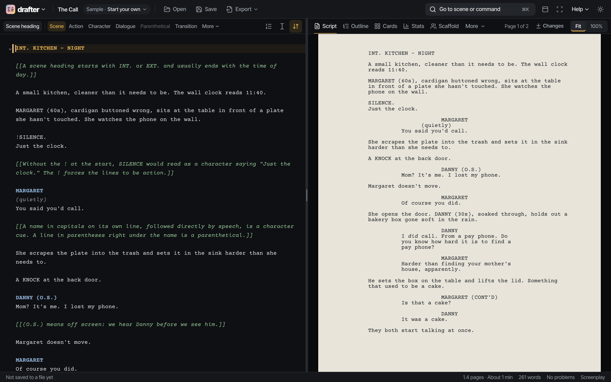
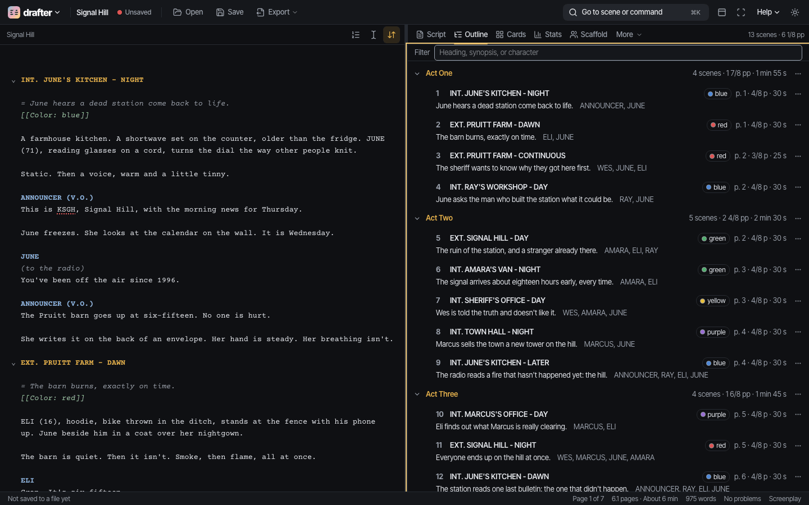
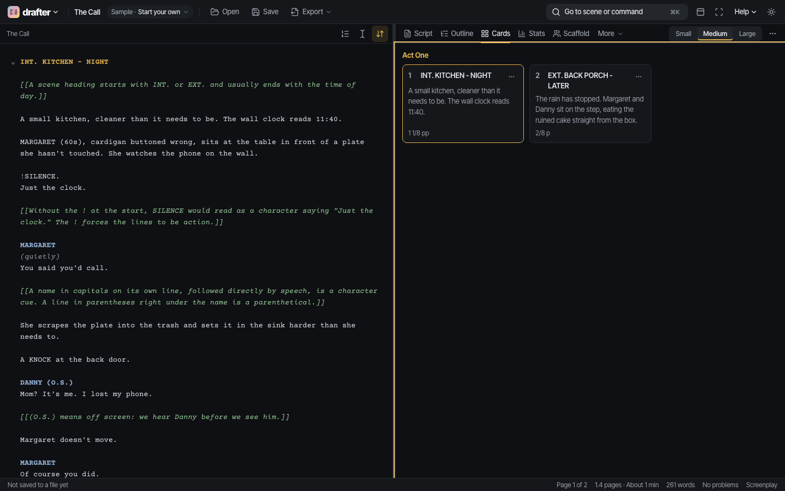
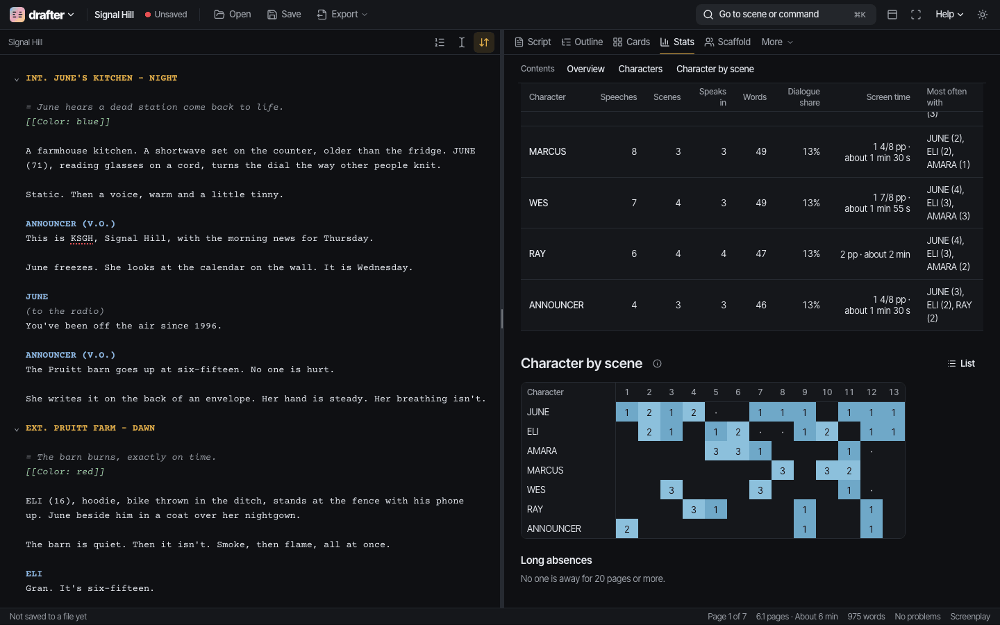
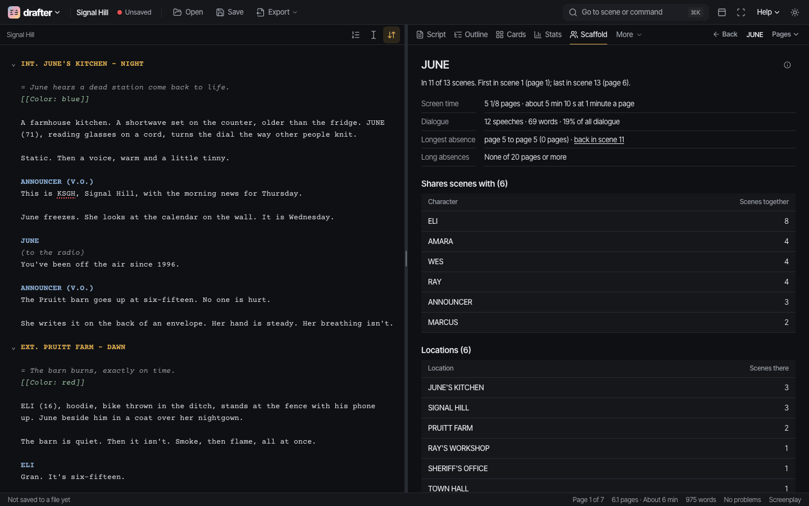
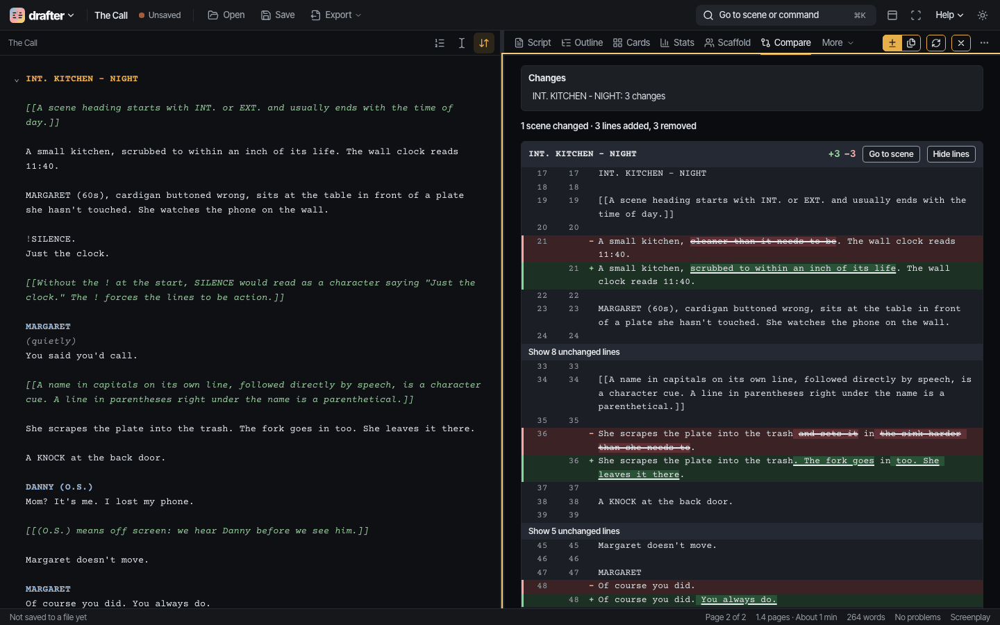
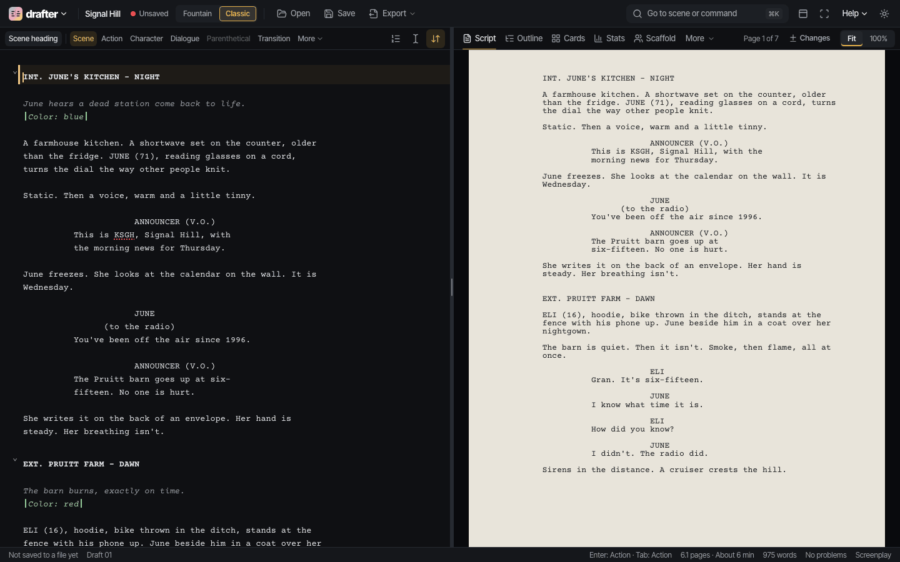
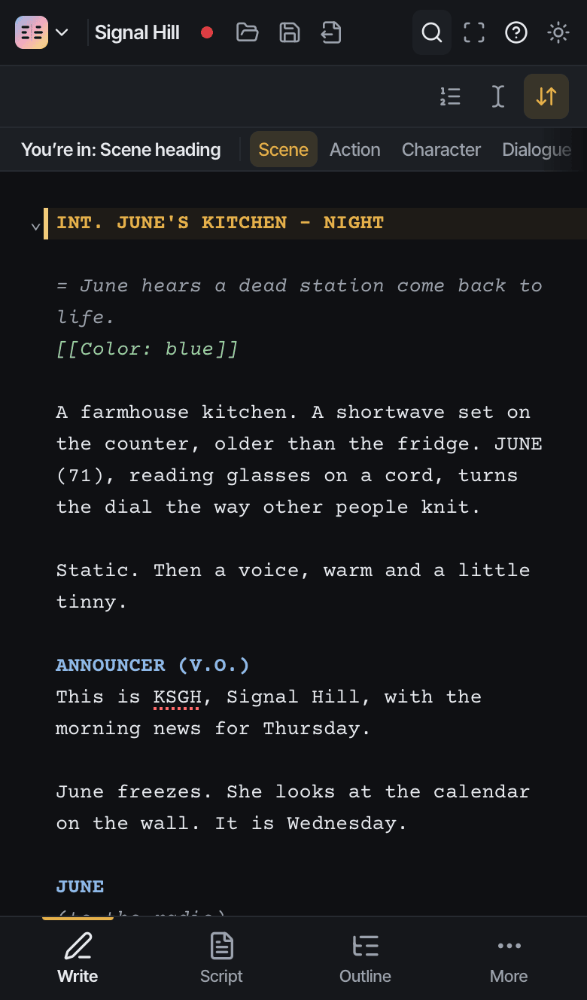
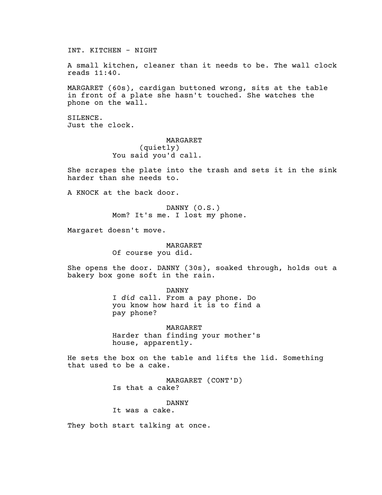

# Drafter


**Drafter™ is a free, open-source writing app for screenplays and stage plays in plain-text [Fountain](https://fountain.io), and for novels and treatments in Markdown: you write on the left, and the formatted pages build on the right as you type.** Rather not learn Fountain's marks? **Classic Mode** types a script with Enter and Tab, the way many screenwriters expect, over a file that stays Fountain.

[](https://github.com/cschweda/drafter/releases/latest)
[](https://github.com/cschweda/drafter/actions/workflows/checks.yml?query=branch%3Amain)
[](https://github.com/cschweda/drafter/actions/workflows/desktop.yml)
[](LICENSE)
[](https://drafter.dev)

<picture>
  <source media="(prefers-color-scheme: light)" srcset="docs/images/drafter-ide-light.png">
  
</picture>

**[Write now at drafter.dev](https://drafter.dev)** · **[Download](https://drafter.dev/docs/download/)** · **[What is Drafter?](https://drafter.dev/docs/what-is-drafter/)** · **[What's new](https://drafter.dev/docs/whats-new/)**

> [!NOTE]
> **Status: v0.25.1.** The web app and the desktop apps for Windows and Linux are ready to use, and Phase 2 is under way. Classic Mode is out, for writers who’d rather type the way many screenwriting apps work than learn Fountain’s marks, and v0.25.1 brings a privacy and a red/blue team audit, a contrast slider for each pane, and typewriter sounds; Novel, a place to draft a book in Markdown, is on `main` and comes in v0.26.0. See the [roadmap](#roadmap).

## Free, no login, private

Open it and write. Drafter is ready the moment the page loads or the app starts.

- **Free, with no catch.** No price, no trial, no subscription, no locked "free tier", and no ads. Drafter isn't a business: one writer makes it, for writers, and gives it away. There is no paid version, and there won't be one.
- **No login, ever.** No sign-up, no sign-in, no licence key, no activation. Close it, open it tomorrow, and you're back in your script.
- **Private.** No cookies, no tracking of you, no telemetry. Drafter has no server that could receive your script, so it never leaves your device. The website, drafter.dev, measures visitor traffic with [Plausible](https://plausible.io/privacy-focused-web-analytics): privacy-first analytics with no cookies, no ads, nothing that identifies you, and no tracking across sites (chosen over Google Analytics for that). It's there only to see the basic traffic and which pages people look at, as a reference for improving Drafter. **The downloaded desktop app has no analytics at all.** See [Privacy](https://drafter.dev/docs/privacy/#analytics).
- **Open.** The code is MIT-licensed. Your script is a plain `.fountain` text file you own, which any app can open and which will still open in fifty years. A lapsed licence can never lock you out of your own work.
- **Instant, and offline.** No installer or setup is needed to begin. Once it has loaded, Drafter runs with no connection, on a plane or a train.
- **No forced updates.** The web app updates when you reload, or the next time you open it after closing every Drafter tab. The desktop app asks GitHub once at start-up whether there's a new version, never installs or restarts by itself, and can be told not to check at all.
- **Plays well with Final Draft.** It opens and saves Final Draft (`.fdx`) files, so you can trade scripts with anyone who uses it.
- **Built for working writers.** The production features a greenlit script needs come to the free app in v0.27.0: colored revision sets with marks in the margin, locked pages (12A) and scene numbers (5A), OMITTED scenes, revised pages to send out, a breakdown report, and sides for actors.

## Privacy: your script stays with you

Writers worry, rightly, about a script getting out before it's ready. Drafter is built so it can't, and an [audit](docs/privacy-audit-2026-11-03.md) checks it.

- **Nothing in the cloud.** No server stores anything about your script, at drafter.dev or anywhere else: not its text, its title, its length, or its name. drafter.dev is a set of static files that sends the app to your browser. It has no database, no accounts, and nowhere to upload to. The desktop app has no server at all.
- **Kept on your device only.** Your script lives in the files you save, plus a recovery copy, its history, drafts, and cuts. In the web app those are in your browser's own storage (IndexedDB) on this device, and in the desktop app in its folder on your computer. Drafts and cuts are also plain files beside your script.
- **No AI.** Drafter has no AI in it: no AI service, no model, and nothing that reads your script to suggest, summarize, or learn from it. Your words never train anything. If you want your own AI app to read your scripts, [Drafter for Claude](https://drafter.dev/docs/drafter-for-claude/) is a separate program you set up yourself. It reads only the folders you name, and Drafter never starts it.
- **It leaves only when you send it.** A file you share, a report you open on GitHub, an email you write: those go because you chose them, and only what you see goes.

**What does use the network, all of it:**

| What | Where to | When | Carries your script? |
|---|---|---|---|
| The app, its fonts, and its dictionaries | drafter.dev itself (or your own server, if you [host it](#self-hosted)) | When the page loads, and when it checks for a new version | No |
| A count of page visits ([Plausible](https://drafter.dev/docs/privacy/#analytics): privacy-first, no cookies, no ads; only to see the basic traffic, for future improvements) | plausible.io | drafter.dev only: each page view and the time on it, each address cut before any `?` or `#`; no clicks, downloads, or forms | No. The desktop app and self-hosted copies don't have it |
| A check for a new version | GitHub | The desktop app, when it starts; you can turn it off in Settings | No. GitHub sees your IP address, version, and system |
| A report or an idea | GitHub, or your email app | Only when you click **Open on GitHub** or **Write an email** | Only what you typed and saw |
| A module you add yourself | The addresses it names | Desktop app only, and only once you agree to them | It can, so add only modules you trust ([more](https://drafter.dev/docs/privacy/#modules)) |

**Checked, not just promised.** The [privacy audit of 3 November 2026](docs/privacy-audit-2026-11-03.md) went through every line of code that could reach the network, every place Drafter stores anything, and every dependency. It also ran a writing session on drafter.dev in Chrome, Firefox, and Safari's engine with every request recorded. A made-up phrase typed into the script appeared in none of them. It found one leak and it was fixed the same day: on drafter.dev, what a report said could reach the analytics when it was opened on GitHub. The [Privacy](https://drafter.dev/docs/privacy/) help page, in the app and on drafter.dev, says the same in more detail.

## Contents

- [Privacy](#privacy-your-script-stays-with-you)
- [Features](#features)
- [Security](#security)
- [Testing](#testing)
- [How Drafter compares](#how-drafter-compares)
- [Get Drafter](#get-drafter)
- [Formats](#formats)
- [Roadmap](#roadmap)
- [For developers](#for-developers)
- [Clean-room implementation](#clean-room-implementation)
- [Acknowledgments](#acknowledgments)
- [License](#license)

## Features

- **Write.** The editor and its live, industry-standard pages, with page counts you can trust. An element bar writes Fountain for you, with a cheat sheet. Screenplay and Stage play templates, a **Novel** for drafting a book, and Markdown documents with footnotes. A command palette, a Problems pane, offline spellcheck in US or British English, focus mode, typewriter scrolling, a daily goal, sprints, and writing stats.
- **Contrast you choose.** The top bar's Contrast button has a slider for the Source and one for the Script, each on its own, in the light and the dark theme. Both start near the highest, for crisp text, and either can go softer if bright text tires your eyes.
- **Fountain or Classic.** Type Fountain's marks, or switch to **Classic Mode**: Enter and Tab move from element to element, names and places fill themselves in, headings and names capitalise themselves, and the left side looks like a script with the marks hidden. The file is plain Fountain either way, and one click in the top bar switches. [How it works](https://drafter.dev/docs/classic-mode/).
- **Novel.** Draft a book in plain Markdown: `#` for a chapter, `##` or `***` for a section, `# Part One` for a part. The Outline and Cards show every chapter and section with its words, a status (To do, Draft, Revised, Done), a synopsis, and a word target; Alt+arrow keys or a drag reorders them. **Focus** shows one chapter or section at a time, and the file stays Markdown any app opens. The manuscript PDF and Word file come in v0.26.1. [How it works](https://drafter.dev/docs/novel/).
- **Shape the story.** **Outline** (scenes and sections as a tree, with synopses, colors, running times, and a treatment export) and **Cards**, both rearranged by drag or keys. **Notes**, with categories, readers' names, and open or resolved status. Scene goals, setups and payoffs, and the **Structure strip**, a band of blocks above the panes to click and go.
- **Look back.** **History**, with every version restorable in one undo. **Compare**, with a GitHub-style view of what changed. **Show changes**, marked on the pages, and the history of one scene.
- **Drafts and Cuts.** Start a new draft when you choose: Draft 01, Draft 02, each kept for good with an ID of its own, to read, compare, or restore, and **Draft by draft** to see how the work changed. **Cuts** keeps everything you cut, a scene, a speech, or a paragraph, to browse for ideas, copy, or put back. Both sit as plain files beside your script.
- **Story map.** One dark page that answers "What are you writing?" in pictures, to send to anyone: the story's shape, its people, and every scene so far, with a few lines of dialogue and what is still to write. It opens on a phone, runs no code, and never includes your notes.
- **Drafter for Claude.** Let Claude (or another AI app you use) read the scripts, drafts, and cuts in folders you choose, for storyboards, notes, and insights across a series. Drafter itself never calls an AI. [Setting it up](https://drafter.dev/docs/drafter-for-claude/).
- **See the script.** **Scaffold** follows your cursor and shows who is in the scene, where, and for how long, with a page for each character and place. The **Stats tab** has each character's screen time and dialogue share, and a character-by-scene grid that shows who vanishes for 20 pages. Running times by scene and act, at your own minutes a page or from the dialogue.
- **Files and formats.** Real `.fountain` files, saved straight back in Chrome and Edge, with a recovery copy kept as you type. Final Draft, Highland, Fade In, and Markdown in; PDF, Final Draft, Markdown, plain text, HTML, EPUB, and a story map out. See [Formats](#formats).
- **Make it yours.** A calm dark theme by default, or light, or one that follows your system. Paper pages or a dark page for night, five text sizes, and optional script modules. Below 1024 pixels, one pane at a time, made for a phone.
- **Get started.** A guided tour on a first visit, a **guided first screenplay** and **stage play** that teach each element as you read, sample scripts under **Help**, and help pages.
- **Desktop.** Apps for Windows and Linux, and a Mac build, that always save in place and open a `.fountain` file with a double-click.

[Everything Drafter does today](docs/WHY.md#everything-drafter-does-today) has the full list.

### A look around

Each shot shows "Signal Hill", a short screenplay written for these pictures, in your GitHub theme.

<p>
<picture><source media="(prefers-color-scheme: light)" srcset="docs/images/drafter-outline-light.png"></picture>
<picture><source media="(prefers-color-scheme: light)" srcset="docs/images/drafter-cards-light.png"></picture>
</p>

**Outline and Cards.** Move a scene in either one, and the Fountain source is rewritten.

<p>
<picture><source media="(prefers-color-scheme: light)" srcset="docs/images/drafter-stats-light.png"></picture>
<picture><source media="(prefers-color-scheme: light)" srcset="docs/images/drafter-scaffold-light.png"></picture>
</p>

**Stats and Scaffold.** Who speaks, how much, where, and for how long.

<picture>
  <source media="(prefers-color-scheme: light)" srcset="docs/images/drafter-compare-light.png">
  
</picture>

**Compare.** What changed since any earlier version, scene by scene.

<picture>
  <source media="(prefers-color-scheme: light)" srcset="docs/images/drafter-classic-light.png">
  
</picture>

**Classic Mode.** The same script, typed with Enter and Tab, with the marks hidden. The file underneath is still Fountain.

<p>
<picture><source media="(prefers-color-scheme: light)" srcset="docs/images/drafter-phone-light.png"></picture>

</p>

**On a phone, and on paper.** One pane at a time on a small screen, and a PDF that looks like what readers, agents, and productions expect.

## Security

Drafter is built to open files from anyone without putting you at risk.

- **Drafter never runs anything in a file it opens.** A script is read as text, and your words are shown as words, never as web code.
- **A strict content security policy.** The web app tells your browser to run only Drafter's own scripts (and, on drafter.dev, Plausible's visit counter), so nothing slipped into a page or a file can run there.
- **No accounts, no server keeping your scripts, no cookies, no tracking of you.** Your files stay on your device; drafter.dev's only analytics is Plausible, which uses no cookies.
- **Size limits are checked before anything is unpacked.** A Highland, Fade In, or EPUB file's entries can't point outside their archive. A Final Draft file never makes Drafter fetch or read anything else: the outside references XML allows are refused.
- **The desktop app** never loads an opened file into a window. It reads the bytes of only the files you chose, and hands them to the editor.
- **Reopening an HTML or EPUB file** reads only the script Drafter embedded in it, as text. A browser opening an HTML file outside Drafter is outside Drafter's control, so treat one someone sent you like any downloaded page (see [Open formats](https://drafter.dev/docs/open-formats/)).
- **Drafter for Claude only reads, and only the folders you name.** It has no code that writes, moves, or deletes a file, starts a program, or opens a connection. A path leading outside your folders, through `..` or a link, is refused, hidden files are never read, and every file is judged by what is inside it, exactly as Open judges it, with the app's size limits. Each request runs in a worker stopped at 10 seconds, answers are capped at 40,000 characters with signed cursors for the rest, and your notes are left out unless you ask. The trap documents have an entry point for it, with path, size, no-write, no-fetch, and no-run traps.
- **The trap documents.** Drafter is tested against [283 deliberately broken and hostile files](fixtures/trap/README.md) for every format it opens: Fountain, Markdown, plain text, Final Draft, Highland, Fade In, HTML and EPUB, and the special files a desktop meets, such as pipes and links. Each has the one outcome it must have: opened with its text, or refused with a plain message. The suite checks that nothing crashes, runs, or fetches anything, and that each finishes within its time limit. The readers and the command line run in a worker that is stopped at the limit, so a hang fails the test. The app's own Open runs in the test's thread, so it is timed but can't be stopped mid-hang ([what is enforced](fixtures/trap/README.md#running-it)). The suite runs with `pnpm test` once the packages are built (`pnpm -r build`), and in the desktop app's CI on every push to `main`.
- **Found a security problem?** Please report it privately: choose **Report a vulnerability** on the repository's [Security tab](https://github.com/cschweda/drafter/security) ([SECURITY.md](SECURITY.md) says what to include), or email cschweda@gmail.com with the details. Never in a public issue.

The [Technical details](docs/technical-details.md#security) give the specifics.

### Audit record

Every audit of Drafter, newest first. The newest is in full; each earlier one is kept here in a line, with its full report in [`docs/`](docs/AUDITS.md).

**Newest: [red/blue team audit, 3 November 2026](docs/redblue-audit-2026-11-03.md).** Four red-team attackers each took one area (the web app and its file formats, the desktop app, the supply chain and release, and privacy) and tried to break it. A blue team then checked each finding, fixed what was real with a test that fails without the fix, and left only GitHub and npm settings for the maintainer. **No attack ran code from a script, a file, or an export, got past the security policy, or reached the network from a page.**

| | Severity | Finding | Mitigation | Status |
|---|---|---|---|---|
| P1 | High | Final Draft exports carried notes and synopses as printed text, even with notes left out | Leave out now leaves them all out; Include says they print | Fixed |
| D1 | High | A compromised desktop page could hand the browser an address holding the script, past every network block | Only Drafter's own links open at once; any other site asks you first | Fixed |
| S1 | High | One stolen credential could push a release, with no tag or branch protection | 7-day waits on new dependencies; tag and branch rulesets and a release environment are for the maintainer | Maintainer |
| W1 | Medium | 160 KB of `*_` in a Markdown file froze the tab, again on every reload | Past 4,000 marks in a paragraph, they're plain text | Fixed |
| W2 | Medium | The same file stalled the Preview and every export after it | That paragraph is refused before parsing, with a trap document to hold it | Fixed |
| P2 | Medium | The script's title goes into the browser's history and tab sync | Settings → Hide the script's title in the tab | Mitigated |
| P3 | Medium | The Story map's logline and synopses went into the browser's form history | `autocomplete="off"` on every text field, with a test | Fixed |
| P4 | Medium | Plausible's script could read the page, and the policy allowed all of plausible.io | The policy allows one script and one address; the help says what can't be checked | Mitigated |
| S2 | Medium | `drafter build` wrote through a planted link, overwriting a file outside the folder | Written beside and renamed, so a link is replaced | Fixed |
| D2 | Low–Medium | A page could open a hidden window with the app's bridge | New windows always get the app's own chrome | Fixed |
| S3–S5, W3–W4, P5–P7, D3 | Low | One huge file broke Drafter for Claude's listing; PR checks unenforced; Docker cached 404s; a template named `constructor` broke Cuts; a slow spellcheck on hyphen chains; cuts in shared folders; EPUB ids linking blind copies; a help line | Each fixed with a test, or warned about in the help; a download handler deferred | Fixed (D3 deferred) |
| W5–W6, S6–S8, D4, P8 | Info | Extra addresses in a contact link, prototype lookups, a loose release check, ignore rules, and smaller notes | Fixed or recorded in [DEFERRED](docs/DEFERRED.md) | Fixed / recorded |

**Earlier audits:**

- **[Privacy audit, 3 November 2026](docs/privacy-audit-2026-11-03.md):** nothing about a script is stored in the cloud, and there's no AI. A writing session in three browsers on live drafter.dev sent the script in no request. One leak was fixed the same day: on drafter.dev, a report's text could reach the analytics.
- **[Security audit, 1 November 2026](docs/security-audit-2026-11-01.md):** the first formal audit. No exploitable hole and nothing leaves the device. Fixed: private vulnerability reporting, the desktop's drop grant, Nuxt 4.6.3, and Dependabot.
- **[Clean-room audit, 1 November 2026](docs/clean-room-audit-2026-11-01.md):** no copied code, no screenwriting package, no GPL code shipped. A film catchphrase and an unrecorded source were fixed.
- **[The trap documents](fixtures/trap/README.md), 1 November 2026 (v0.23.2):** 258 hostile files, now 283, each with the one outcome it must have, run on every pull request.
- **Reopenable exports review, 1 November 2026 (v0.23.1):** only the embedded source is read, as text, with caps before unpacking.
- **Accessibility pass, 28 October 2026 (v0.9.0):** automated axe checks in every browser and both themes. Screen-reader passes are still to come.
- **[Clean-room audit, 27 October 2026](docs/clean-room-audit-2026-10-27.md):** passed, with two fixes.
- **Desktop review, 27 October 2026 (v0.4.0):** WebRTC closed, folder modules kept apart, and updates checked by SHA-512.

## Testing

Drafter holds your script, so its tests guard two promises above all: **a change to the app never loses or alters a word you wrote, and a file you open can only be read, never do anything.** They check this by using Drafter the way you would, thousands of times over, before any change is kept.

**What runs.** As of v0.25.1, there are **7,997 unit and property tests** (in 21 packages, the web app, and the desktop app), **1,361 browser tests**, each run in five browser setups (6,805 runs), 138 end-to-end tests of the desktop app, and **283 trap documents** with 1,305 checks:

- **Unit tests** check each piece on its own: the Fountain parser, the page layout, the PDF, every import and export, saving, drafts, and the editor's keys.
- **Property tests** generate thousands of random scripts and check rules that must hold for every one of them, not just for the examples someone thought of. For instance, a script read and written back comes out the same, and Classic Mode never writes anything you couldn't have typed by hand.
- **Browser tests** open the built app and type, click, save, export, and reopen, the way a writer does. They run in Chrome's, Firefox's, and Safari's engines, on a desktop screen and on a phone, with accessibility checked in both themes. The desktop app has its own tests, in Electron.
- **The [trap documents](fixtures/trap/README.md)** are broken and hostile files, sent through every way a file comes in, each with the one outcome it must have.
- **Time limits** fail a test when Drafter is too slow: opening a huge file, a keystroke in a long script.

**When it runs.**

- **While a change is made,** its tests are written first where they can be: a test that fails, then the code that makes it pass.
- **On every proposed change (CI).** Continuous integration means GitHub's computers run the checks on every pull request before it can be merged, so nothing gets in because someone forgot to run the tests, or because it only worked on one computer. That covers the linter, the build, every package's type check and tests, the trap documents, a Docker check, and the browser tests on macOS and Linux. Tests with a time limit are skipped there, as GitHub's shared computers are slower.
- **Before each release,** every test runs once, with its time limits and in all five browser setups, on a real computer. Then GitHub builds and tests the Linux and Windows apps, and the release is published only if every one passes.

**What tests can't do.** Passing tests show that what they check is right, not that nothing is wrong. A test that sometimes fails for no clear reason gets rerun and looked into, never switched off. Each big change is also tried by hand before it ships, and the screen-reader checks are done by a person. [Technical details](docs/technical-details.md#how-its-tested) has the specifics, and [Developing Drafter](docs/DEVELOPMENT.md#test-counts-and-diagrams) has the commands.

## How Drafter compares

What each app's maker says on its own site, as of October 2026, at list prices (sales come and go). ✓ means it's there; *paid* means a higher plan; ? means the maker doesn't say. Drafter's not-yet-shipped features show the version they're planned for, never a ✓. Corrections are welcome: [open an issue](https://github.com/cschweda/drafter/issues). The same table is on [Why Drafter](https://drafter.dev/docs/why/), with the reasons behind it.

| | **Drafter** | Final Draft 13 | WriterDuet | Fade In | Highland Pro | Arc Studio | Celtx |
|---|---|---|---|---|---|---|---|
| **Price** | **Free, forever** | $249.99 once, or $99.99/yr | from $9.99/mo | $99.95 once | $59.99/yr | from $69/yr | from $11.24/mo |
| **Free version** | **Everything** | 5-day trial | 3 projects | Watermarked demo | 30-day trial | 2 scripts, watermark | 1 project |
| **Account or sign-in** | **Never** | Store sign-in, 2 computers | Yes | Registration key | App Store | Yes | Yes |
| **Open source** | **✓ MIT** | ✗ | ✗ | ✗ | ✗ | ✗ | ✗ |
| **Your data** | **Stays on your device; no tracking** | On your computer | Cloud | On your computer | On your computer | Cloud | Cloud |
| Mac / Windows / Linux | build it / ✓ / ✓ | ✓ / ✓ / ✗ | ✓ / ✓ / ✓ | ✓ / ✓ / ✓ | ✓ / ✗ / ✗ | ✓ / ✓ / web | web; Mac app |
| Web, and phones | ✓ web, works on phones | iPhone app | ✓ | mobile apps | iPhone, iPad | ✓ | ✓ web |
| Works fully offline | ✓ | ✓ | paid plans | ✓ | ? | ✓ | ✗ |
| Final Draft (.fdx) open / save | ✓ / ✓ | ✓ / ✓ | ✓ / ✓ | ✓ / ✓ | ✓ / ✓ | ✓ / ✓ | open / ? |
| Fountain open / save | ✓ / ✓ (its own format) | as plain text only | ✓ / ✓ | open / ? | ✓ / ✓ | ✓ / ✓ | ✓ / ✓ |
| PDF import | planned, free | ✓ | ✓ | ✓ | ✓ | ✓ | ✓ |
| Outline and index cards | ✓ | ✓ | ✓ | partial | partial | *paid* outline | ✓ |
| Notes | ✓ | ✓ | ✓ | ✓ | ✓ | ✓ | *paid* |
| Version history and Compare | ✓ / ✓ | ✓ / ? | ✓ / partial | ✓ / ✓ | ? | *paid* | *paid* |
| Character and scene stats | ✓ | ✓ reports | *paid* reports | ✓ reports | partial | ✓ reports | *paid* |
| Revision colors and marks | v0.27.0, free | ✓ | *paid* | ✓ | ✓ | *paid* | *paid* |
| Locked pages and scene numbers, OMITTED | v0.27.0, free | ✓ | *paid* | ✓ | ? | ✓ | ? |
| Breakdown report and sides | v0.27.0, free | ✓ / ? | ✓ / partial | ✓ / ? | ✗ | partial | *paid* |
| Stage play | ✓ | ✓ | ✓ | ✓ | ✓ | ? | ✓ |
| TV templates | Phase 3, free | ✓ | ✓ | ✓ | ✓ | ✓ | *paid* |
| Spellcheck | ✓ offline | ? | ? | ✓ | ? | ✓ | ? |
| Focus mode, goals, sprints | ✓ | ✓ | ✓ | partial | ✓ | ✓ | ? |
| Read aloud (table read) | Phase 4, free | ✓ | *paid* | ✓ | ? | *paid* credits | ? |
| Dark mode | ✓ | ✓ | ✓ | page colors | ✓ | ✓ | page colors |
| Real-time co-writing | later, free | each writer needs a licence | inviter pays | ✓ | ✗ | *paid* | *paid* |

Sources: each maker's own pricing, features, and help pages (Final Draft, WriterDuet, Fade In, Quote-Unquote Apps for Highland Pro, Arc Studio, Celtx), read on 31 October 2026. Every app here is good at what it does; Drafter's difference is that all of it is free, open, and never asks you to sign in.

## Get Drafter

**On the web:** open [drafter.dev](https://drafter.dev) and write, on a computer or a phone, offline once it has loaded. Chrome and Edge save straight back to your file; other browsers download a copy ([Storage and browsers](docs/DEVELOPMENT.md#storage-and-browsers)). Install it as an app from the address bar to keep it in your Dock or Start menu.

**On the desktop:** the same editor in a window of its own, built with Electron. It always saves in place, keeps its recovery copy in its own folder where no browser can clear it (`~/.config/Drafter`; on Windows `%APPDATA%\Drafter`), opens a `.fountain` file with a double-click, has a menu bar and a modules folder, and asks **Save**, **Don't Save**, or **Cancel** before closing. It always works offline, and makes no network request but one update check at start, never installs by itself (the AppImage and Windows offer **Restart**, the `.deb` **Get it**), and the check can be turned off in Settings. [Drafter on the web and on the desktop](docs/web-and-desktop.md) compares the two.

### Windows

For Windows 10 and 11 on 64-bit Intel or AMD: `Drafter-<version>-windows-x64-setup.exe`, from the [Download page](https://drafter.dev/docs/download/) or the [latest release](https://github.com/cschweda/drafter/releases/latest) under *Assets*. It installs at once, for you alone, with no administrator, and adds Drafter to the Start menu. The installer isn't signed yet, so if **SmartScreen** says *"Windows protected your PC"*, choose **More info**, then **Run anyway**. There's no Windows on Arm (arm64) installer for now; on Windows 11 on Arm (a Snapdragon laptop, or a VM on an Apple silicon Mac) the x64 installer runs under Windows' built-in emulation, a little slower than a native app would. The [Windows install guide](docs/desktop-install-windows.md) has the steps, where everything is, updates and what they're checked for, uninstalling, the modules folder, and building the installer yourself.

### Linux

For 64-bit Intel and AMD (x64), from the [Download page](https://drafter.dev/docs/download/) or the [latest release](https://github.com/cschweda/drafter/releases/latest):

| Package | Use it on | File |
|---|---|---|
| `.deb` | Ubuntu, Debian, Linux Mint, Pop!_OS, and other Debian-based systems. **The one to use on Ubuntu 24.04 and later.** | `Drafter-<version>-linux-amd64.deb` |
| AppImage | Any other distribution (Fedora, Arch, openSUSE, and so on). Nothing to install. | `Drafter-x86_64.AppImage` |

```sh
sudo apt install ./Drafter-<version>-linux-amd64.deb             # the .deb; then start it with drafterdev
chmod +x Drafter-x86_64.AppImage && ./Drafter-x86_64.AppImage    # the AppImage
```

The AppImage needs FUSE 2 (`libfuse2`), and on Ubuntu 24.04 and later an AppArmor profile for Chromium's sandbox, so use the `.deb` there. The [Linux install guide](docs/desktop-install-linux.md) has starting, file types, removing it, the sandbox choices, and updates.

### Mac

There's no Mac download yet: a Mac app from the internet has to be signed and notarized with an Apple developer account, which Drafter doesn't have yet. A signed download that updates itself comes later. Until then, the same app builds on your own Mac with one command, and opens there without any warning. You need Node 22.13 or later, pnpm 10 (`corepack enable`), and `git`:

```sh
git clone https://github.com/cschweda/drafter.git
cd drafter
pnpm install
pnpm desktop:mac
```

Then drag `apps/desktop/release/mac-arm64/Drafter.app` (on an Intel Mac, `apps/desktop/release/mac/Drafter.app`) to **Applications**. To update, run `git pull`, `pnpm install`, and `pnpm desktop:mac` again. The [Mac guide](docs/desktop-install-macos.md) has what to install first, opening files, where Drafter keeps things, updating, removing it, and what to do if something goes wrong. Or skip the build, and install [drafter.dev](https://drafter.dev) as an app from Chrome or Edge: it sits in your Dock, works offline, and saves straight back to your files.

### Self-hosted

Run the web app from your own computer or server, so nothing loads from drafter.dev. You need [Docker](https://docs.docker.com/get-started/get-docker/).

```sh
git clone https://github.com/cschweda/drafter.git
cd drafter
docker compose up -d
```

The first run builds the app, which takes a few minutes. Then open `http://localhost:8080`. To stop it, run `docker compose down`. To update, run `git pull`, then `docker compose up -d --build`. It stores no scripts and has no analytics. The [Self-hosting](https://drafter.dev/docs/self-hosting/) page has more.

**The downsides:**

- **You keep it up to date.** Nothing updates by itself, security fixes included.
- **It's still a browser app.** Your work lives in the browser and in the files you choose, so clearing the browser's site data can clear what's kept there, and save-in-place depends on the browser.
- **Your scripts don't follow you.** A browser keeps each address separate, so scripts kept in the browser at drafter.dev won't appear at `localhost`. Save them to files and open them there.
- **Other devices take more work.** It listens only on its own computer. Reaching it from elsewhere needs your own HTTPS proxy, because browsers allow offline use, installing, and saving in place only on `localhost` or HTTPS. It has no sign-in, so anyone who can reach the address can open the app, though they'd see only what's in their own browser.
- **Docker has to be running,** and it's a sizeable program to install just for this.

**Why the downloaded app may suit you better:** if what you want is privacy, the [desktop app](#get-drafter) is usually the better choice, on Windows or Linux. It has no analytics, needs no Docker or server, and works offline. It always saves in place, and keeps its recovery copy in its own folder where no browser can clear it. Self-hosting makes more sense if you want the browser version, can't install apps, are on a Mac and don't want to build the app, or want to serve Drafter to a group from a server you run.

## Formats

Fountain is where you write. Everything else is a door in or a door out.

- **In:** Fountain (`.fountain`, `.txt`) opens as it is. Final Draft (`.fdx`), Highland (`.highland`), and Fade In (`.fadein`) open as a new script. Markdown (`.md`) opens as a document, or as a screenplay; a **Novel** is a Markdown file that names its template in a trailing comment, so it opens in any Markdown app too. Drafter's own HTML and EPUB exports open again when saved with **Let Drafter reopen this file**. Anything else (Word, RTF, PDF, other web pages and e-books, an image) is refused, with a sentence saying what to do instead.
- **Out:** PDF, Final Draft (`.fdx`), Markdown, plain text, Fountain, a typeset PDF of a Markdown document, a self-contained web page (HTML), an e-book (EPUB), and a **story map**, one picture-first HTML page of the script or play for someone who doesn't read scripts, with no code and no notes in it. Export options per script set the scene numbers, the title page, and whether your notes go along.
- **Beside your script:** a drafts folder (`Boca drafts/Boca – Draft 01.fountain`, each draft a complete Fountain or Markdown file) and a cuts file (`Boca.fountain.cuts.md`, plain Markdown), written by the desktop app and by Chrome and Edge once you allow the folder; elsewhere, a zip to download.

The file you open is never changed, and no words go missing silently: text Fountain has no element for comes in as a note, listed in Problems.

The same code runs in a terminal:

```sh
drafter build script.fountain --pdf script.pdf     # a PDF; --txt for plain text, --html for a web page
drafter build script.fountain --story-map map.html # a story map, to send to anyone
drafter convert ~/Scripts                          # every .fdx, .highland, and .fadein in the folder, to Fountain
```

[Formats](docs/FORMATS.md) has the tables, what each import keeps and leaves behind, reopening HTML and EPUB files, and every command-line option.

## Roadmap

**Done so far:** the engine, the web app with its accessibility pass, desktop apps for Linux and Windows and a Mac build, and most of Phase 2: Outline, Cards, Notes, History and Compare, spellcheck, the Structure strip, Scaffold and Stats, every main import, HTML and EPUB export, Drafts and Cuts (v0.24.0): numbered drafts, and a permanent file of everything you cut, Story map (v0.24.1): a visual page of your script to send to anyone, and Drafter for Claude (v0.24.2): let Claude or another AI app read the scripts, drafts, and cuts in folders you choose. You can also host the web app yourself with Docker (v0.24.3), and type a script with Enter and Tab the way many screenwriters expect, over a file that stays Fountain, in Classic Mode (v0.25.0).

**Next:**

- **v0.26.0: Novel**, a comfortable place to draft a novel in Markdown: built and on `main`, awaiting its release. Chapters, sections, and parts, an Outline and Cards with status and synopsis, focus on one passage, and word targets.
- **v0.26.1: the manuscript exports**, a PDF and a Word file in manuscript layout.

**Later:**

- **Production, free (v0.27.0):** revision colors and marks, locked pages and scene numbers, OMITTED scenes, revised pages, a breakdown report, and sides.
- Storylines, the strip's Color by, and pacing (v0.28.0).
- The **Workbook** (v0.29.0): a story bible and scene cards, with your pasted, synced, and spoken notes.
- An optional one-file `.drafter` project (v0.30.0, open spec).
- Reader notes with no account, and the Reference tab (v0.31.0 and v0.32.0).
- A signed Mac download, **PDF import**, **real-time co-writing** (free, end-to-end encrypted, no account), and testing with NVDA and VoiceOver, last of all.

**Not planned:** accounts, a paid version, or a Drafter server that keeps your scripts. The [full roadmap](docs/ROADMAP.md) has every phase.

## For developers

Drafter is a pnpm monorepo in TypeScript: the Nuxt 4 web app in `apps/web`, the Electron desktop app in `apps/desktop`, the engine as framework-free `@drafter/*` packages in `packages/`, and Drafter for Claude, a read-only MCP server, in `packages/mcp` (published as `drafter-mcp`). With Node 22.13 or later and pnpm 10:

```sh
pnpm install
pnpm -r build
pnpm -r test
pnpm dev              # the app, at http://localhost:3000
```

Found a bug or have an idea? **Help → Report a problem…** or **Suggest an idea…** in the app fills in a [GitHub issue](https://github.com/cschweda/drafter/issues/new/choose) for you to submit, or email cschweda@gmail.com; security problems go through [SECURITY.md](SECURITY.md).

[How Drafter works](docs/HOW-IT-WORKS.md) has four diagrams of it. [Developing Drafter](docs/DEVELOPMENT.md) has how it works, the packages, the stack, storage and browsers, every command, the samples, contributing (commits, the changelog, releasing), and the design documents. [Why Drafter](docs/WHY.md) has the idea behind it and its principles, and [`docs/DECISIONS.md`](docs/DECISIONS.md) records the choices along the way.

## Clean-room implementation

Drafter is written from scratch, from public specifications, without reading anyone else's implementation. Nobody working on the code reads the source of other screenwriting apps or Fountain libraries, and none of them is a dependency. Drafter uses ordinary open-source libraries, but no code from any other screenwriting or playwriting application, and no Fountain library. That keeps the MIT license sound, and lets people trust where the engine came from.

A repository-wide audit on 27 October 2026 found no copied code, and [a second on 1 November 2026](docs/clean-room-audit-2026-11-01.md), over everything since, found none either. The rule binds every contributor, AI coding assistants included. [The clean-room rules](docs/DEVELOPMENT.md#clean-room-implementation) are in Developing Drafter, and [Clean-room implementation](docs/clean-room.md) has the whole statement.

[Audits](docs/AUDITS.md) lists every security and clean-room audit, newest first.

---

Made by Christopher Schweda ([cschweda](https://github.com/cschweda)), who also builds [metaincognita](https://metaincognita.com): open-source casino simulators that show the math behind the games.

## Acknowledgments

- [Fountain](https://fountain.io), the plain-text screenplay format created by John August and Stu Maschwitz, with many contributors.
- The [Inform 7](https://ganelson.github.io/inform-website/) IDE, Graham Nelson's environment for interactive fiction, whose two facing panes, plain source on one side and the result on the other, Drafter borrows ([in full](docs/WHY.md#acknowledgments-in-full)).
- [Courier Prime](https://fonts.google.com/specimen/Courier+Prime), the screenplay typeface, and [Inter Tight](https://fonts.google.com/specimen/Inter+Tight), the typeface of the wordmark and interface, both under the SIL Open Font License.

## License

[MIT](LICENSE) © 2026 Christopher Schweda. Courier Prime and Inter Tight are distributed under the SIL Open Font License, each with its license file alongside the fonts. The logo, icons, and share image are in [`brand/`](brand/). See the [Changelog](CHANGELOG.md) for every release.

**Trademark.** Drafter™ and the Drafter logo are trademarks of Christopher Schweda. The MIT License covers the code, so you are free to use, change, and share it; it doesn't grant use of the Drafter name or logo. A changed copy you share needs a name of its own.
