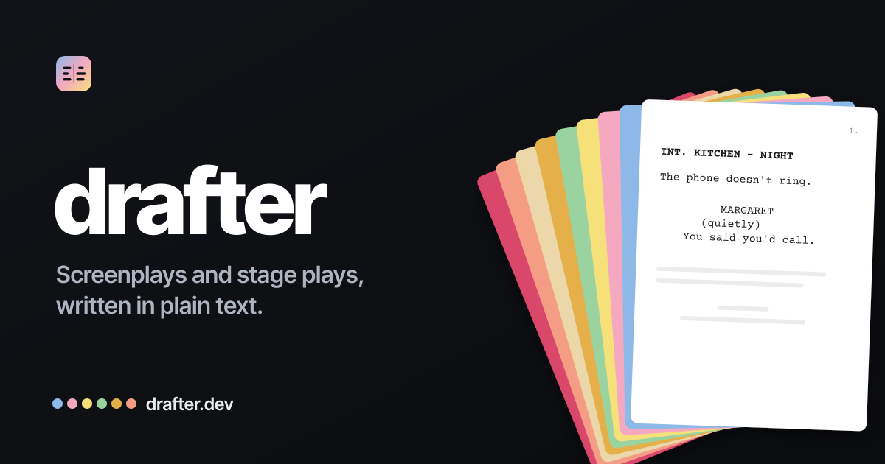
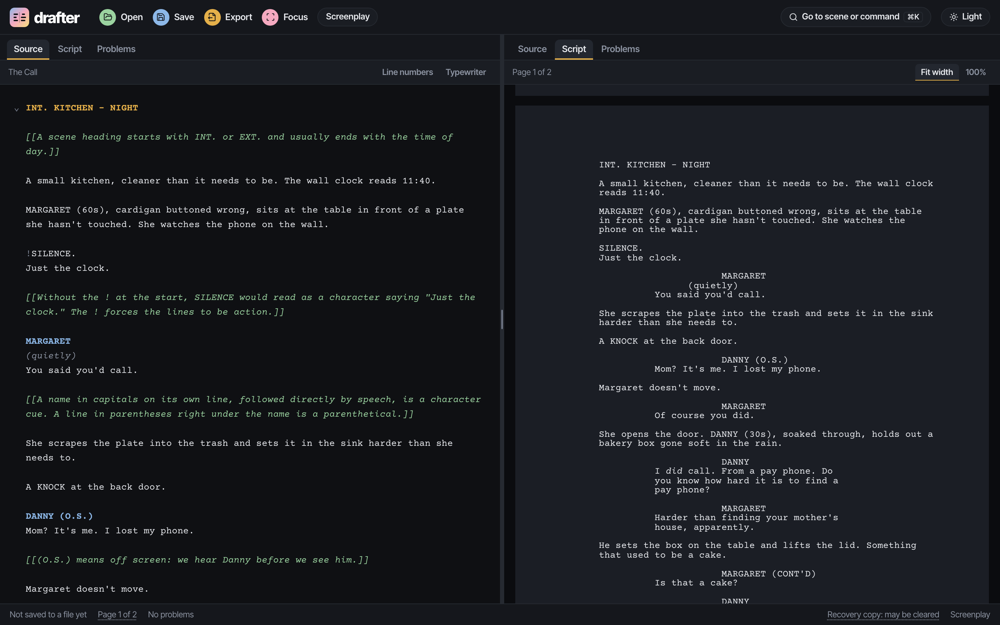

# Drafter

**An open-source, local-first, zero-login writing app, Fountain first: screenplays and stage plays in plain-text [Fountain](https://fountain.io), and novels and treatments in Markdown.** Write on the left; see the paginated, industry-formatted pages on the right, updating as you type.

**Fountain first, every main format out.** Drafter is built around Fountain, plain text that any app can open and that will still open in fifty years. But a script is never locked in: Drafter opens Final Draft, Highland, Fade In, Markdown, and plain-text files, and exports PDF, Final Draft (`.fdx`), Markdown, and plain text, so it can go wherever it needs to go. See [Formats](#formats).

> [!NOTE]
> **Status: v0.20.0. You can write at [drafter.dev](https://drafter.dev), [install Drafter on Linux](#drafter-for-linux) or [on Windows](#drafter-for-windows), or [build it on your Mac](#drafter-on-a-mac).** Phase 1's web app is done, with its accessibility pass, and Phase 2 is under way, now with version history (deleted scenes you can put back, your changes marked on the pages, and GitHub-style diffs), Highland and Fade In imports, Open as screenplay, Export as Markdown, footnotes in Markdown documents, and `drafter convert`. Next: Plan E, "Seeing the script", with Scaffold (v0.21.0, and its second part as v0.23.0), Export as HTML (v0.22.0), then Plans F to H (v0.24.0 to v0.26.0); a signed macOS download follows. See the [roadmap](#roadmap).

**What you can do today**

- **Write:** the editor and its live pages; an element bar that writes Fountain for you, with a cheat sheet; Screenplay and Stage play templates, and plain Markdown documents, with footnotes; the command palette, settings, the Problems pane, and optional script modules.
- **Shape the story:** **Outline** (scenes and sections as a tree, with synopses, colors, each one's running time, and a treatment export) and **Cards** (an index card for every scene), both rearranged by drag or keys; **Notes** (every note and boneyard in one list, with categories, readers' names, and open or resolved status); scene goals; setups and payoffs; and the [**Structure strip**](#the-idea), a band of blocks above the panes to click and go.
- **Look back:** **History** (earlier versions, kept as you write and save, each restorable in one undo); **Compare**, with a **Changes** view like a GitHub diff (grouped by scene, + and − in red and green or blue and orange, the changed words marked) beside the script's **Pages**; **Deleted scenes**, every scene you cut, with **Put back**; **Show changes**, what you've changed since your last save, marked on the pages; and **History of this scene**, every version of one scene.
- **Check spelling:** Drafter's own spellcheck, offline, in US or British English, with a dictionary of your own and one for each script.
- **Keep going:** focus mode, typewriter scrolling, counts, a daily goal, sprints, and writing stats.
- **Time it:** the running time at your own minutes a page and an estimate from the dialogue, set per script in Stats, with each scene's and act's time in the Outline and the Structure strip.
- **Files:** Save and Open for real `.fountain` files (saved straight back to the file in Chrome and Edge on a computer, downloaded elsewhere), with a recovery copy kept in your browser as you type; every main format in and out, from Final Draft to Markdown, and `drafter convert` for a folder at once (see [Formats](#formats)); a progress bar on a long export; and **export options** per script for scene numbers, the title page, and notes.
- **Get started:** a welcome and a guided tour on a first visit; a **guided first screenplay** and **stage play** (File → New guided screenplay) that teach each element as you read; offline use and installing as an app; help pages, among them **Technical details** (how Drafter is built, with diagrams); and, under Help in the menu, **About Drafter** (the version, for a bug report, and the links), [**Sample scripts**](#samples), and **Check for updates**.
- **On the desktop:** an app for Linux (an AppImage or a `.deb`) and Windows (an installer) that always saves in place and loads script modules from a folder. It builds on a Mac with one command.

<picture>
  <source media="(prefers-color-scheme: light)" srcset="docs/images/drafter-ide-light.png">
  
</picture>

[drafter.dev](https://drafter.dev) · [MIT License](LICENSE) · [Changelog](CHANGELOG.md)

## Contents

- [The idea](#the-idea)
- [Principles](#principles)
- [What makes it different](#what-makes-it-different)
- [How it works](#how-it-works)
- [Formats](#formats)
- [Samples](#samples)
- [Packages](#packages)
- [Roadmap](#roadmap)
- [Stack](#stack)
- [Storage and browsers](#storage-and-browsers)
- [Drafter for Linux](#drafter-for-linux)
- [Drafter for Windows](#drafter-for-windows)
- [Drafter on a Mac](#drafter-on-a-mac)
- [Development](#development)
- [Clean-room implementation](#clean-room-implementation)
  - [Clean-room verification](#clean-room-verification)
- [Contributing](#contributing)
- [Design documents](#design-documents)
- [Acknowledgments](#acknowledgments)
- [License](#license)

## The idea

Drafter does for screenwriting what the [Inform 7](https://ganelson.github.io/inform-website/) IDE does for interactive fiction. You work in a plain-text **source** on the left and see the **compiled** result, a paginated script, on the right. Everything Drafter knows about the script is derived from the source. There is no hidden document model, no proprietary file format, no account, and no server.

```
┌──────────────────────────────┬──────────────────────────────────┐
│ SOURCE · Fountain            │ SCRIPT · OUTLINE · CARDS · NOTES │
│                              │ PROBLEMS · STATS · REFERENCE     │
│                              │                              7.  │
│ INT. KITCHEN - NIGHT         │  INT. KITCHEN - NIGHT            │
│                              │                                  │
│ MARGARET sits at the table,  │  MARGARET sits at the table,     │
│ not eating.                  │  not eating.                     │
│                              │                                  │
│ MARGARET                     │              MARGARET            │
│ (quietly)                    │           (quietly)              │
│ You said you'd call.         │        You said you'd call.      │
│                              │                                  │
├──────────────────────────────┴──────────────────────────────────┤
│ p. 7 of 94 · 2 problems · saved 2 min ago · US Screenplay       │
└─────────────────────────────────────────────────────────────────┘
```

The left pane is a [CodeMirror 6](https://codemirror.net) editor showing the raw Fountain, markup and all. The right pane is tabbed:

| Tab | What it shows | Arrives in |
|---|---|---|
| **Script** | The paginated, formatted script, built from the same page model as the PDF export. Click a line to jump to it in the source. | Phase 1 |
| **Problems** | Lint results, like a compiler's error list. Click to jump. | Phase 1 |
| **Outline** | Sections, scenes, synopses, scene colors, page counts, and running times. Reorder scenes by drag or keyboard, and the source is rewritten. | Phase 2 (built) |
| **Cards** | An index-card view of scenes with synopsis and color, moved by drag or keyboard. | Phase 2 (built) |
| **Beat Board** | A free canvas of idea cards to color, link, and move into the outline, with storylines shown in color. | Phase 2 |
| **Notes** | Every `[[note]]` and `/* boneyard */` in one place, linked to its position, with categories, readers, and open or resolved status. | Phase 2 (built) |
| **Stats** | Page count, running time at your own rate and an estimate from the dialogue, dialogue share per character, INT/EXT and DAY/NIGHT breakdowns, pacing. | Phase 2 |
| **Reference** | Fountain syntax and the active template's formatting rules, built in. | Phase 2 |

Above both panes, the **Structure strip** (Phase 2, built) shows the whole script at once: your sections and scenes as a band of blocks, each as wide as its share of the pages and tinted by its scene color, with a page ruler. Click a block, or press Enter on it, to go there. It's off until you turn it on from the toolbar, the palette, Settings, or Ctrl+Alt+O (⌘⌥O on a Mac).

Either pane can be collapsed, for "just write" or "just read."

## Principles

1. **The source is the truth.** A `.fountain` file is the whole project. Anything Drafter adds, such as scene colors, a script dictionary, or revision marks, is stored in Fountain syntax or in a single metadata block at the end of the file that other Fountain tools ignore. The file stays readable in Beat, Highland, Slugline, BetterFountain, or any text editor.
2. **Local-first, offline-first.** Your work lives in files on your own disk, with a recovery copy in your browser. Drafter is a static site: nothing to pay for, nothing to log into, nothing that can be shut off.
3. **Formats are templates, and templates are data.** US screenplay, stage play, sitcom, radio drama: each is a declarative JSON template that the engine applies. You can add your own.

## What makes it different

- **Source and script side by side, always.** You edit text, not a rich document, and the markup stays visible. Tab and Enter insert plain Fountain, so the familiar screenwriting-app keystrokes still work.
- **A Problems pane.** A linter for scripts: unclosed notes, cues with no dialogue, near-duplicate character names, and more, with click-to-jump. Drafter reads common Fountain mistakes leniently, and its Strict Fountain checks can rewrite the file into spec form for other tools.
- **Stage plays as a first-class format.** A Dramatists Guild–style template and a documented convention for writing plays in standard Fountain.
- **Runs anywhere with a browser.** Chromebook, Linux, Windows, Mac, or iPad, with no install and no sign-up, and offline once installed as an app.
- **Accessibility as a feature.** WCAG 2.2 AA is the target, checked automatically with axe in every major state; testing with screen readers comes [last](#roadmap). A screen-reader user can navigate the rendered script by structure, and every drag-and-drop has a keyboard equivalent.
- **The engine is a library.** The parser and pagination engine are standalone packages, so they also power a CLI (`drafter build script.fountain --pdf script.pdf`, or `--html script.html`), CI checks, and other tools.
- **Table read** (Phase 4). The browser's speech synthesis reads the script aloud with a different voice for each character.

## How it works

```
Fountain source ──parse──▶ syntax tree ──────▶ outline · cards · lint · spellcheck · stats
       ▲                        │
       │                        └──layout(template)──▶ pages ──▶ Script pane · PDF · .txt
       │
       └──── every edit, from any view, is a text change to the source
```

- **One parser, one buffer.** `@drafter/fountain` produces a concrete syntax tree that keeps every block's raw text and surrounding whitespace, so `print(parse(text)) === text` for any input, well-formed or not. Editor highlighting comes from the same parse; there is no second grammar to drift out of sync.
- **Edits are text.** Sections, synopses, and scene headings already live in the file, so outlining is not a second document that can drift: renaming a character, moving a scene, or editing a synopsis on a card all become text changes to the source. Everything is undoable, and the file is always the truth.
- **Pagination is a pure function.** Screenplays use 12-point Courier: 10 characters and 6 lines to the inch. Layout works in characters and lines rather than pixels, so it runs anywhere (a Web Worker in the app, Node in the CLI), and the screen and the PDF come from the same page model.
- **Templates drive the format.** A template sets the page size and margins; each element's indent, width, case, and spacing; dialogue-splitting rules (`(MORE)` and `(CONT'D)`); and a *role map* that assigns roles such as stage direction, act heading, or sound cue to standard Fountain elements, so no new syntax is needed.

## Formats

Fountain is where you write. Everything else is a door in or a door out.

### In: opening a file

| File | What Drafter does |
|---|---|
| Fountain (`.fountain`, `.txt`) | Opens it as it is. Save writes it back. |
| Final Draft (`.fdx`) | Opens a copy as a new script: scenes, dialogue, dual dialogue, transitions, the title page, scene numbers, and notes. |
| Highland (`.highland`) | Opens the script inside as a new script. |
| Fade In (`.fadein`) | Opens a copy as a new script, read from its Open Screenplay Format. |
| Markdown (`.md`) | Opens as a Markdown document (a treatment, notes, or a novel), or, with **Open as screenplay…**, as a script typed in Fountain. |
| Anything else (Word, RTF, PDF, an image) | Refused, with a sentence saying what to do instead. |

The file you open is never changed. Text that Fountain has no element for (hidden text, an omitted scene, a paragraph style of the writer's own) comes in as a note, such as `[[fdx: …]]` or `[[osf: …]]`, listed in Problems, so no words go missing silently. Formatting with no place in Fountain, such as fonts and revision colors, is left behind.

### Out: exporting

| Export | What you get |
|---|---|
| **PDF** | The pages exactly as the Script tab shows them, in Courier Prime 12 pt, on US Letter or A4. |
| **Final Draft** (`.fdx`) | A file that Final Draft, Fade In, WriterDuet, and most other screenwriting apps open. |
| **Markdown** | The whole script as readable Markdown, with your notes if you ask, or the Outline's treatment. Good for sharing, for a wiki, and for AI tools. |
| **Plain text** | The laid-out pages as text, to paste anywhere. |
| **Fountain** | Save. Highland, Beat, Slugline, and any text editor read it. |
| **A Markdown document's PDF** | A typeset document: headings, lists, links you can click, and footnotes at the foot of the page. |

Export options, per script, set the scene numbers (none, as written, or every scene), how much of the title page prints, and whether a Markdown export carries your notes. Drafter doesn't write Highland or Fade In files: Highland opens Fountain directly, and Fade In opens Final Draft.

### From the command line

The same code runs in a terminal ([Development](#development) shows how to build it):

```sh
drafter build script.fountain --pdf script.pdf     # a PDF; --txt for plain text
drafter build script.fountain --html script.html   # one HTML page, pages and reading view, to open anywhere
drafter convert MyScript.fdx                      # MyScript.fountain, beside it
drafter convert ~/Scripts                         # every .fdx, .highland, and .fadein in the folder
drafter convert ~/Scripts --recursive             # and in its subfolders
drafter convert ~/Scripts --out ~/Fountain        # into another folder
drafter convert ~/Scripts --force                 # replace .fountain files that are there already
```

`convert` uses the app's own import code, so each `.fountain` is what opening the file in Drafter and saving it would give. It never changes the originals, skips a `.fountain` that is already there unless you add `--force`, writes each file whole or not at all (on a drive with no hard links, such as FAT or exFAT, a crash mid-copy can still leave a short file), prints a line for each file and a summary, and exits 1 if any file was refused.

## Samples

[`samples/`](samples/) has three sets:

- **The same story twice**, as a [screenplay](samples/screenplay.fountain) and a [stage play](samples/stage-play.fountain), to show how Drafter's Fountain works and how the two formats differ. Neither is complete. Notes in double brackets explain each piece of syntax in the source and never print. In the app, a first visit opens on the screenplay, and both are under Open → Samples.
- **Two synthetic Final Draft files** in [`samples/fdx/`](samples/fdx/), written by hand with invented values (not made in Final Draft), to try Open on. The app doesn't list them.
- **Three much smaller ones**, written for the app, under Help → **Sample scripts**: a screenplay and a stage play, each under a page (the screenplay uses every Fountain element once; the stage play its acts, scenes, cues, and stage directions), and a Markdown document. Each opens as a new script of your own, leaving the one you had open as it was. Below them are the two guided starters, a first screenplay and a first stage play that teach Fountain as you read.

How the two formats differ:

| | Screenplay | Stage play |
|---|---|---|
| Template | US Screenplay, the default | Stage Play, chosen by the metadata block at the end of the file |
| Scenes | `INT. KITCHEN - NIGHT` | `## Scene 1`, with the set described in a stage direction |
| Acts | `# Act One`, an outline marker that doesn't print | `# Act One`, printed as a centered heading |
| Description | Action, in plain type | Stage directions, indented and in italics |
| Character names | Indented about 3.7 inches from the page edge | Centered |
| A voice from off stage | `(O.S.)` | `(offstage)` |
| Transitions | `CUT TO:` | None; lighting changes are stage directions |
| A speaker continuing after action | `(CONT'D)`, added automatically | Not marked |

## Packages

The engine is a set of framework-free TypeScript packages, published as `@drafter/*`. Only `cm-fountain` depends on CodeMirror. Two packages touch the DOM (`render-html` builds it, and `cm-fountain` drives CodeMirror's view); the rest run anywhere Node does.

| Package | What it does | Phase |
|---|---|---|
| `@drafter/fountain` | Fountain text ⇄ syntax tree: lossless printing, fast full reparse | 0 |
| `@drafter/templates` | Template schema, validation, inheritance (`extends`), built-in formats | 0 |
| `@drafter/layout` | Pagination: syntax tree + template → pages | 0 |
| `@drafter/render-pdf` | Pages → PDF, with Courier Prime embedded; Markdown documents in Inter Tight | 0 (Markdown documents in 2) |
| `@drafter/cli` | `drafter build` (PDF, HTML, text, JSON), `drafter check`, and `drafter convert` (Final Draft, Highland, and Fade In to Fountain) | 0 (published in 5; `convert` in v0.20.0) |
| `@drafter/cm-fountain` | CodeMirror 6 integration: highlighting, keymap, autocomplete, folding | 1 |
| `@drafter/render-html` | Pages → DOM for the Script tab | 1 |
| `@drafter/render-html-file` | Export as HTML: a script or a Markdown document as one self-contained, offline `.html` file, dark by default, with a light switch | 2 (in progress for v0.22.0) |
| `@drafter/render-text` | Pages → fixed-width text, as `drafter build --txt` writes it | 1 |
| `@drafter/lint` | Problems-pane rules | 1 (starter set), 2 (setups and payoffs, and duplicate scene fields), 4 (the rest) |
| `@drafter/notes` | Keyed notes (`[[Head: body]]`): reading and writing them, scene headers' field order, categories, and the text helpers structural edits share | 2 (built in Plan B) |
| `@drafter/compare` | The line diff behind Compare: what changed between two versions of a script, and where it sits in the newer one; the rows, word marks, folds, and scene groups of the Changes view | 2 (built in Plan C; the Changes view in version history) |
| `@drafter/history` | Version history: which scenes of past versions are gone now, every version of one scene, and where Put back puts a scene | 2 (built in version history) |
| `@drafter/outline` | Condense and expand, scene reordering, synopsis, color, and Scene details edits, the Structure strip's geometry, each scene's timing, and the whole script as Markdown | 2 (built in Plans A and B, and the Structure strip) |
| `@drafter/spell` | Offline spellcheck (nspell): the words worth checking, the two bundled English dictionaries, and a per-script dictionary | 2 (built in Plan D) |
| `@drafter/fdx` | Final Draft (`.fdx`) import and export, and Open Screenplay Format import | 2 (built in Plan FD; OSF in v0.19.0) |
| `@drafter/archive` | Highland and Fade In files: a strict read-only zip reader, and the script inside each | 2 (built in v0.19.0) |
| `@drafter/markdown` | Markdown documents: the parser (CommonMark with GitHub's footnotes), footnote numbering, the title, and the word count, shared by the Preview and the PDF (which takes only the footnote walk, `@drafter/markdown/notes`, and never loads the parser) | 2 (moved out of the app in v0.22.0) |
| `@drafter/stats` | Script statistics | 2 (planned) |

Repository layout:

```
drafter/
├── apps/web/      # the Nuxt 4 app for drafter.dev
├── apps/desktop/  # the Electron desktop app for Linux, Windows, and macOS
├── packages/      # the @drafter/* engine packages
├── modules/       # the optional script modules
├── samples/       # the sample scripts
├── fixtures/      # original test scripts
├── brand/         # the logo, icons, and share image
└── docs/          # design documents
```

A `templates/` folder for community templates, as plain JSON, is planned.

## Roadmap

The ordering principle: the reasons to choose Drafter must be on screen at the first public release. That's why the Problems pane, the stage-play template, and accessibility come early, Final Draft files follow the outline, and radio and TV formats come later.

| Phase | Theme | Shipped | Still to come |
|---|---|---|---|
| 0 | Engine: parser, templates, pagination, PDF, CLI | **Done** | |
| 1 | Minimum IDE: the first public release | **Live at drafter.dev**; the desktop app for Linux (v0.4.0) and Windows (v0.8.0), and a Mac build (v0.7.0) | A signed macOS download |
| 2 | Structure | **Under way**: writing stats by day (v0.5.0), the Outline (v0.10.0), Final Draft import and export (v0.11.0), Cards and Notes with scene goals and setups and payoffs (v0.12.0), History and Compare (v0.13.0), spellcheck (v0.14.0), the Structure strip (v0.15.0), PDF export for Markdown documents (v0.16.0); guided starters, export options, running times by scene, and a Technical details page (v0.17.0); version history with deleted scenes, Show changes, and GitHub-style diffs (v0.18.0); Highland, Fade In, and Markdown imports, Open as screenplay, and Export as Markdown (v0.19.0); `drafter convert` and footnotes in Markdown documents (v0.20.0) | **Next:** Export as HTML (v0.22.0) and Plans E to H (v0.21.0, v0.23.0, and v0.24.0 to v0.26.0), starting with Plan E, "Seeing the script": the Beat Board, storylines, the Stats and Reference tabs, Scaffold (who is in each scene, with a page for each character and location), a script map, a pacing view, a character-by-scene grid, and reader notes with no account |
| 3 | Formats | Planned | Celtx import; TV, radio, UK/BBC, and novel templates; user templates; French scenes and doubling charts for plays; `.html` export; PDF with notes in the margin or a watermark; a self-contained reader file |
| 4 | Craft | Planned | Revision marks and production pages, alternate lines, a clean display mode, table read, a character pass, story order, a breakdown report, accepting a co-writer's changes, one character's dialogue for an actor, the remaining lint rules, a PWA install flow |
| 5 | Community | Planned | npm packages and the CLI, a VS Code extension, a template gallery and docs site, a plugin API only if there's demand |
| Later | | Planned | Open from and save to Dropbox and Google Drive directly, signed in with them, never with Drafter |
| Last | | Planned | Testing with NVDA and VoiceOver, after every phase is built. Until then every view is built for screen readers and checked automatically, and Drafter claims no conformance with any standard |

**Not planned:** accounts, a Drafter server, or sync through Drafter. From Phase 1, a script saved in a folder that Dropbox, Google Drive, iCloud, or Syncthing keeps in sync syncs like any other file, in browsers that save in place. PDF import is out of scope through Phase 4.

The full list for each phase, with what each item does and when Phase 0 counts as done, is in the [architecture document, §13](docs/drafter-architecture.md#13-phased-plan); the [Phase 1](docs/drafter-phase1-design.md) and [Phase 2](docs/drafter-phase2-design.md) designs have the details.

## Stack

| Concern | Choice |
|---|---|
| Language | TypeScript (strict, ESM) in pnpm workspaces |
| App shell | Nuxt 4 as a single-page app, with Nuxt UI v4 |
| Source editor | CodeMirror 6, highlighted by `@drafter/fountain` rather than a second grammar |
| Script rendering | HTML and CSS with Courier Prime, from the same page model as the PDF |
| PDF | pdf-lib, with fontkit for the embedded fonts |
| Storage | IndexedDB (via Dexie) and the File System Access API |
| Offline | Progressive Web App |
| Spellcheck | nspell with offline Hunspell dictionaries |
| Tests | Vitest and fast-check for the engine, Playwright for the app |
| Deploy | Static site on Netlify |

## Storage and browsers

Drafter never needs an account, and it saves like a desktop app. Your script is a `.fountain` file: Save writes it, and Drafter warns you before you leave with unsaved changes. Behind that, your browser keeps a recovery copy at all times, updated as you type, so a crash or a closed tab loses almost nothing.

| | Chrome, Edge, and other Chromium browsers | Firefox | Safari |
|---|---|---|---|
| Recovery copy in the browser | ✅ | ✅ | ✅ |
| Save back to the file you opened | ✅ | Downloads a new copy | Downloads a new copy |
| Warning before leaving with unsaved changes | ✅ | ✅ | ✅ |
| Import by drag-and-drop or file picker | ✅ | ✅ | ✅ |
| Export by download | ✅ | ✅ | ✅ |

- **Brave** is the exception among Chromium browsers: it ships with the File System Access API turned off, so it saves by download, like Firefox and Safari.
- **The leave warning** is a desktop-browser feature; phones and tablets don't show it reliably, which is one more reason the recovery copy is always on.
- **When the recovery copy isn't safe**, because the browser blocks storage or may clear it, Drafter tells you. Safari, for example, can clear storage for websites you haven't used recently; installing Drafter as an app (Add to Dock, or Add to Home Screen) protects it.
- **Every saved file is a complete `.fountain`**, so any copy is a full backup.

The full policy is in the [architecture document, §6](docs/drafter-architecture.md#6-storage-and-files-no-logins-ever).

## Drafter for Linux

The same editor as drafter.dev, in a window of its own, built with Electron. Get it from the [latest release](https://github.com/cschweda/drafter/releases/latest) on GitHub, for 64-bit Intel and AMD (x64):

| Package | Use it on | File |
|---|---|---|
| `.deb` | Ubuntu, Debian, Linux Mint, Pop!_OS, and other Debian-based systems. **The one to use on Ubuntu 24.04 and later.** | `Drafter-<version>-linux-amd64.deb` |
| AppImage | Any other distribution (Fedora, Arch, openSUSE, and so on). Nothing to install. | `Drafter-x86_64.AppImage` |

```sh
sudo apt install ./Drafter-<version>-linux-amd64.deb             # the .deb; then start it with drafterdev
chmod +x Drafter-x86_64.AppImage && ./Drafter-x86_64.AppImage    # the AppImage
```

The AppImage needs FUSE 2 (`libfuse2`), and on Ubuntu 24.04 and later it needs an AppArmor profile for Chromium's sandbox, so use the `.deb` there. Drafter checks GitHub once at start for a new version and never installs by itself: the AppImage offers **Restart**, the `.deb` **Get it**, and you can turn the check off in Settings. The [Linux install guide](docs/desktop-install-linux.md) has starting, file types, removing it, the sandbox choices, and updates.

**How it differs from drafter.dev:** it always saves straight back to your file, keeps its recovery copy in its own folder (`~/.config/Drafter`; on Windows `%APPDATA%\Drafter`) where no browser can clear it, opens a `.fountain` file with a double-click, has a menu bar, asks **Save**, **Don't Save**, or **Cancel** before closing, works offline always, and makes no network request but the update check. [Drafter on the web and on the desktop](docs/web-and-desktop.md) has the full comparison.

## Drafter for Windows

The same desktop app, for Windows 10 and 11. From the [latest release](https://github.com/cschweda/drafter/releases/latest), under *Assets*:

| Your PC | The installer |
|---|---|
| Most PCs (64-bit Intel or AMD) | `Drafter-<version>-windows-x64-setup.exe` |
| Windows on Arm (a Snapdragon laptop, or Windows 11 in a VM on an Apple silicon Mac) | `Drafter-<version>-windows-arm64-setup.exe` |

Open it and it installs at once, for you alone and with no administrator, with Drafter in the Start menu and `.fountain` files opening in it with a double-click. The installer isn't signed yet, so **SmartScreen** may say *"Windows protected your PC"*: choose **More info**, then **Run anyway**. Updates work as with the AppImage. The [Windows install guide](docs/desktop-install-windows.md) has the steps, where everything is, updates and what they're checked for, uninstalling, the modules folder, and building the installers yourself.

## Drafter on a Mac

There's no Mac download yet: a Mac app from the internet has to be signed and notarized with an Apple developer account, which Drafter doesn't have yet. A signed download that updates itself comes later. Until then, the same desktop app builds on your own Mac with one command, and opens there without any warning. With Node 22.13 or later, pnpm 10 (`corepack enable`), and `git`:

```sh
git clone https://github.com/cschweda/drafter.git
cd drafter
pnpm install
pnpm desktop:mac
```

Then drag `apps/desktop/release/mac-arm64/Drafter.app` (on an Intel Mac, `apps/desktop/release/mac/Drafter.app`) to **Applications**. To update, run `git pull`, `pnpm install`, and `pnpm desktop:mac` again. The [Mac guide](docs/desktop-install-macos.md) has the details: what to install first, opening files, where Drafter keeps things, updating, removing it, and what to do if something goes wrong.

**Or skip the build:** open [drafter.dev](https://drafter.dev) in Chrome or Edge and install it as an app (the install button in the address bar). It sits in your Dock, works offline, and saves straight back to your files. The desktop app adds a recovery copy no browser can clear, double-clicking a `.fountain` file to open it, a menu bar, and a modules folder.

## Development

You need Node 22.13 or later (`.nvmrc` pins Node 22) and pnpm 10.

```sh
nvm use               # Node 22, from .nvmrc
pnpm install          # also enables the repository's Git hooks
pnpm -r build
pnpm -r test          # every package's tests
pnpm bench            # parse and pagination timings for a feature-length script
pnpm biome check .
pnpm dev              # the app, at http://localhost:3000
pnpm e2e              # builds the app from clean, as Netlify would, and runs its browser tests
```

- **Browser tests** need Playwright's browsers, installed once with `pnpm --filter @drafter/web exec playwright install chromium firefox webkit`.
- **Git hooks:** `pnpm install` points Git at `.githooks/`, so the changelog check runs on every push. In a clone where you skip the install, run `git config core.hooksPath .githooks` once.
- **Package READMEs:** [`fountain`](packages/fountain/README.md), [`templates`](packages/templates/README.md), [`layout`](packages/layout/README.md), [`render-pdf`](packages/render-pdf/README.md), [`render-html`](packages/render-html/README.md), [`render-html-file`](packages/render-html-file/README.md), [`render-text`](packages/render-text/README.md), [`lint`](packages/lint/README.md), [`cm-fountain`](packages/cm-fountain/README.md), [`cli`](packages/cli/README.md), [`notes`](packages/notes/README.md), [`compare`](packages/compare/README.md), [`outline`](packages/outline/README.md), [`spell`](packages/spell/README.md), [`fdx`](packages/fdx/README.md), [`archive`](packages/archive/README.md), and [`markdown`](packages/markdown/README.md).
- **Decisions and deferred work:** choices the design documents leave open are recorded in [`docs/DECISIONS.md`](docs/DECISIONS.md), and work saved for later phases in [`docs/DEFERRED.md`](docs/DEFERRED.md).

After a build, the CLI runs from the repository root:

```sh
pnpm drafter build samples/screenplay.fountain                 # writes samples/screenplay.pdf
pnpm drafter build samples/stage-play.fountain --txt -         # fixed-width text to the terminal
pnpm drafter check samples/stage-play.fountain                 # diagnostics; exits 1 on any error
pnpm drafter convert ~/scripts --out ~/fountain                # every .fdx, .highland, .fadein to .fountain
```

The stage play picks its own template from the metadata block at the end of the file; `--template` overrides it. The [CLI's README](packages/cli/README.md) has every option.

**Deployment.** drafter.dev deploys on Netlify from this repository, with the site's package directory set to `apps/web`. That directory's [`netlify.toml`](apps/web/netlify.toml) sets the build command, the publish directory, and Node 22. Each build writes a `_headers` file whose content security policy allows only the inline scripts that build produced.

## Clean-room implementation

Drafter is written from scratch, from public specifications, without reading anyone else's implementation. A clean-room implementation keeps two things apart: *what a program has to do*, which comes from public written sources, and *how the code does it*, which comes only from the people writing it. Because nobody working on the code reads another implementation's source, nothing in it is copied from one. It describes the project's practice; it isn't legal advice.

- **Permitted:** the [Fountain specification](https://fountain.io/syntax), industry formatting conventions for screenplays and stage plays, general software engineering, `.fdx` files a user owns (read as plain XML), the public descriptions of the `.highland` and `.fadein` packages and the published Open Screenplay Format specification, other applications used as a writer uses them (their documentation, and comparing their output with Drafter's), and the Courier Prime typeface.
- **Excluded:** the source code of other screenwriting applications and Fountain libraries (Beat, Final Draft, Trelby, Scrite, BetterFountain, afterwriting, Highland, Slugline, Fade In, and any other), not to copy, adapt, or read for ideas; their packages as dependencies; and their test suites, sample files, and scripts.
- **Why:** Drafter's MIT license holds only if none of the code is borrowed, and the engine is meant to be reused by people who need to trust where it came from.
- **From here on:** the rule covers every contributor, every package, and every phase, AI coding assistants included. Where the specification is silent, the decision goes in [`docs/DECISIONS.md`](docs/DECISIONS.md), with a test that pins it.

[Clean-room implementation](docs/clean-room.md) has the whole statement: the permitted sources and what each is used for, why it works in law (and the IBM PC BIOS precedent), why it matters, and what it asks of future development, Final Draft support included.

### Clean-room verification

**The short version: Drafter uses ordinary open-source libraries, but no code from any other screenwriting or playwriting application, and no Fountain library.**

On 27 October 2026 the whole repository was audited against these rules. It found no code from screenwriting software and no Fountain or screenwriting package among more than 700 installed, no copied code from anywhere, general-purpose libraries only, each declared in [`docs/DEPENDENCIES.md`](docs/DEPENDENCIES.md) with no GPL code in the app, and original test content. Most of Drafter's code was written by an AI coding assistant working under these rules and reviewed by the maintainer. An audit finds copying that leaves traces; it can't prove that something was never read or remembered, or rule out what an AI model learned in training.

The [summary of findings](docs/clean-room.md#clean-room-verification) names the commits audited, and [the full audit](docs/clean-room-audit.md) has the method and evidence for each check.

## Contributing

**The clean-room rule.** While working on Drafter, **don't read the source code of other screenwriting applications or Fountain libraries**, and don't add their packages as dependencies. Reading their documentation, using their apps, and comparing their output are all fine. [Clean-room implementation](docs/clean-room.md) explains what's allowed, why, and how to handle the cases in between.

**Test content is original.** Screenplays are almost never in the public domain, so every fixture is written for this project. Placeholder names and nonsense dialogue are fine; third-party scripts and sample files are not.

**Commits** follow [Conventional Commits](https://www.conventionalcommits.org/en/v1.0.0/): `type(scope): summary`, for example `feat(fountain): parse dual dialogue`.

**Every push updates [`CHANGELOG.md`](CHANGELOG.md).** Add entries under `[Unreleased]` as you work. The pre-push hook in `.githooks/` rejects a push when none of its commits touch the changelog.

**Releasing.** In this order, and never by hand before the tag:

1. On `main`, set the version in every versioned `package.json` (including `apps/desktop/package.json`, which names the desktop packages), move the `[Unreleased]` entries into a section for the version and date, and commit. Don't push `main` yet: pushing it deploys drafter.dev, whose Saving page links to the latest release.
2. Push the tag first: `git tag vX.Y.Z && git push origin vX.Y.Z`. The tag must match `apps/desktop/package.json`'s version, or the workflow stops.
3. Let `.github/workflows/desktop.yml` make the release. After every check passes, its `publish` job creates the GitHub Release as a draft, uploads the AppImage, the `.deb`, `latest-linux.yml`, the two Windows installers, and `latest.yml`, checks them, and only then publishes it. It waits for the Linux job and both Windows jobs; if any of them fails, nothing is published. Once it is published, push `main`, so the site's download link never points at a release without packages.
4. Then edit the release's notes on GitHub (the workflow writes a one-line placeholder).

Don't create the release on GitHub (or with `gh release create`) before the workflow does: the workflow never uploads to a release that is already published, so a hand-made release would be left with no packages and no update feed, and the desktop apps would find no update.

## Design documents

- [High-level architecture](docs/drafter-architecture.md): the vision, the IDE model, the data model, storage, templates, and the phased plan.
- [Technical design](docs/drafter-technical-design.md): how each package works, from the parser and pagination to storage, linting, accessibility, security, and testing.
- [Phase 0 kickoff prompt](docs/drafter-phase0-kickoff-prompt.md): the self-contained brief for building the engine.
- [Phase 1 design](docs/drafter-phase1-design.md): the first public release, from the first visit and its guided tour to the editor, saving, export, focus mode, and phones, with mockups in [`docs/phase1/`](docs/phase1/).
- [Phase 2 design](docs/drafter-phase2-design.md): structure, from the shared scene index and the keyed-note convention to the Outline, Cards, Notes, snapshots and Compare, spellcheck, the script map, Stats, the Beat Board, reader notes, and Reference, and the plans that ship them.
- [Structure strip design](docs/drafter-structure-strip-design.md): the band of sections and scenes above the panes, its rows, sizes, keys, and how Phase 2's script map and Timeline build on it.
- [Markdown PDF design](docs/drafter-markdown-pdf-design.md): a Markdown document as a printable PDF: what prints, line and page breaks, paper, and page numbers.
- [Getting a script out the door](docs/drafter-out-the-door-design.md): the guided starters, export options, running times, and the Technical details page.
- [Version history design](docs/drafter-version-history-design.md): Deleted scenes, Show changes, Compare's Changes view, History of this scene, and matching a scene across versions.
- [Technical details](docs/technical-details.md): how Drafter is put together, in plain words first, with diagrams: the packages, from a keystroke to the page, storage, export, offline use, the desktop app, the clean-room rule, releases, and every dependency. The same page is in the app, under Help.

The architecture and technical design are drafts (v0.2) and will change as each phase settles open questions.

## Acknowledgments

- [Fountain](https://fountain.io), the plain-text screenplay format created by John August and Stu Maschwitz, with many contributors.
- The [Inform 7](https://ganelson.github.io/inform-website/) IDE, Graham Nelson's environment for writing interactive fiction. Drafter takes none of the interactive fiction itself (the parser games in the line of Zork and Enchanter), only the IDE: two facing panes, plain source on one side and the result on the other, tabs that either pane can show, and how easily that lets you write, see the outcome, and go straight back to the line that produced it.
- [Courier Prime](https://fonts.google.com/specimen/Courier+Prime), the screenplay typeface Drafter targets, released under the SIL Open Font License.
- [Inter Tight](https://fonts.google.com/specimen/Inter+Tight), the typeface of Drafter's wordmark and interface, also under the SIL Open Font License.

## License

[MIT](LICENSE) © 2026 Christopher Schweda. Courier Prime and Inter Tight are distributed under the SIL Open Font License, each with its license file alongside the fonts. The logo, icons, and share image are in [`brand/`](brand/).
