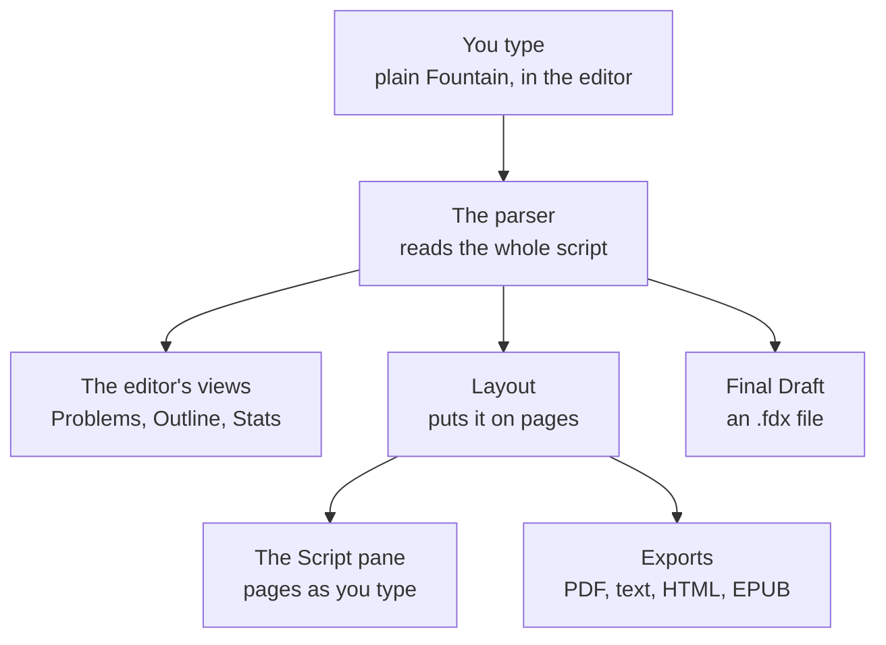
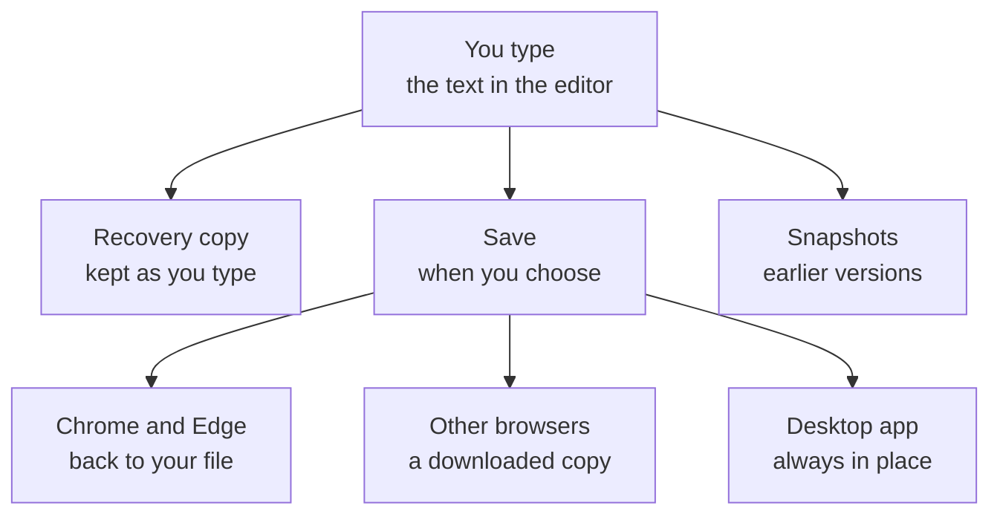
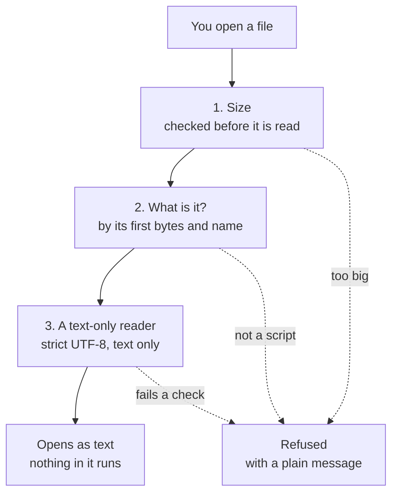
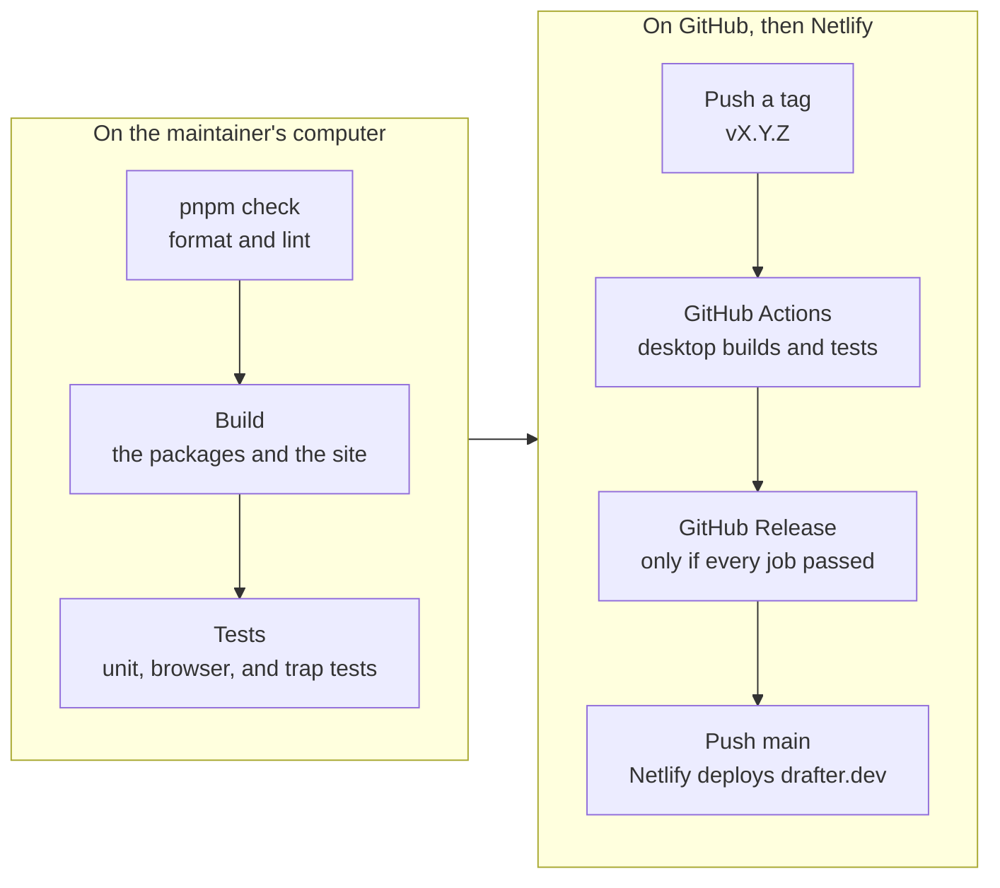

# How Drafter works

Four diagrams of how Drafter works: how a script flows, how saving works, how a file is opened safely, and how a release is made. GitHub draws them from the Mermaid below. The [What is Drafter?](https://drafter.dev/docs/what-is-drafter/#how-it-works) page shows the same diagrams, drawn ahead of time as images, so the app never loads Mermaid. [Technical details](technical-details.md) has more, and [Developing Drafter](DEVELOPMENT.md) has the code.

Each diagram's source is a file in [`diagrams/`](diagrams/). After changing one, run `pnpm diagrams`, which draws it again for the app (see [Developing Drafter](DEVELOPMENT.md#test-counts-and-diagrams)), and copy it here. A test checks that this page, the files, and the drawings agree.

## How a script flows

You type plain Fountain in the editor. The parser (`@drafter/fountain`) reads the whole script. From that come the editor's views (Problems, Outline, and Stats), a Final Draft `.fdx` file, and the layout (`@drafter/layout`), which puts the script on pages. From the pages come the Script pane, as you type, and the exports: PDF, plain text, HTML, and EPUB.

## How saving works

The text in the editor goes three ways: a recovery copy, kept in your browser's IndexedDB as you type; Save, when you choose; and snapshots, the earlier versions History keeps. Save goes back to your file in Chrome and Edge, downloads a copy in other browsers, and in the desktop app always saves in place, with the recovery copy in its own folder.

## How a file is opened safely

First the size is checked, before the file is read: Open never reads a file over 32 MB, and a script over 5 MB is refused. Then Drafter works out what the file is, from its first bytes and its name, and refuses what isn't a script (Word, RTF, PDF, a picture) with a sentence saying what to do. Then a reader that takes only text reads it: strict UTF-8 for Fountain, Markdown, and plain text; the Final Draft, Highland, and Fade In readers, which never fetch or follow anything outside the file; and, for Drafter's own HTML and EPUB exports, only the script embedded in them, never the page. A file that passes opens as text, and nothing in it runs. The [trap documents](../fixtures/trap/README.md) test every step.

## How a release is made

On the maintainer's computer: `pnpm check` (Biome's formatting and lint), the build, and the tests (the packages', the web app's, the browser tests in five projects, and the trap documents). Then the tag is pushed, and the desktop workflow on GitHub Actions builds, tests, and packages the Linux and Windows apps, and publishes the GitHub Release only if every job passes. Then `main` is pushed, and Netlify builds and deploys drafter.dev. [Releasing](DEVELOPMENT.md#contributing) has the steps.

