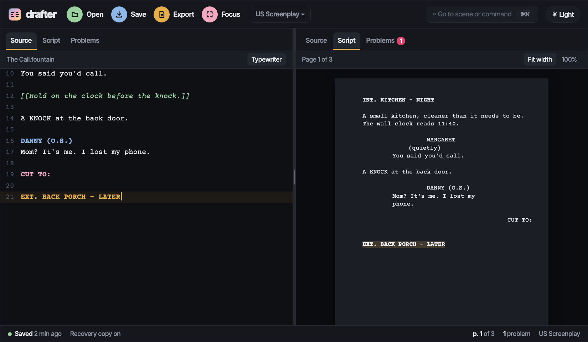
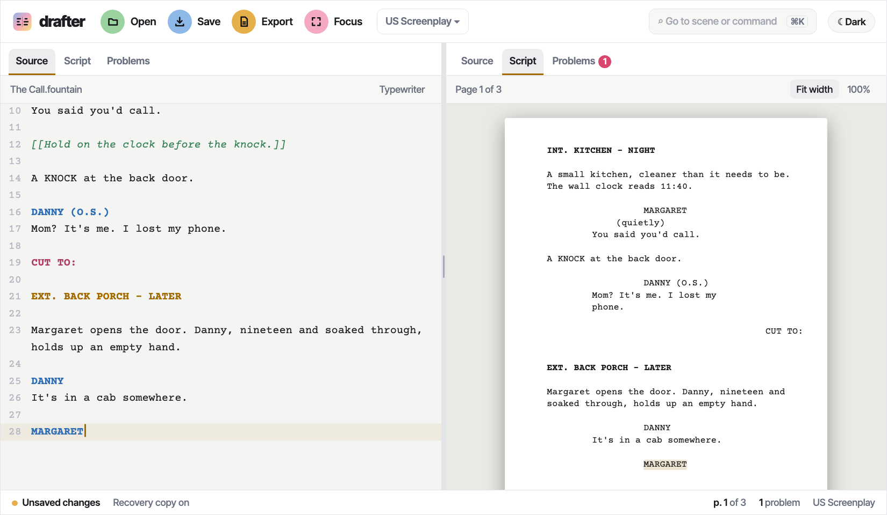
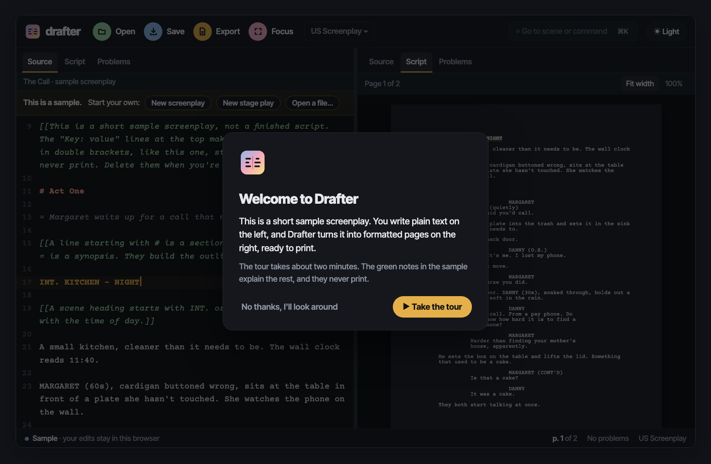
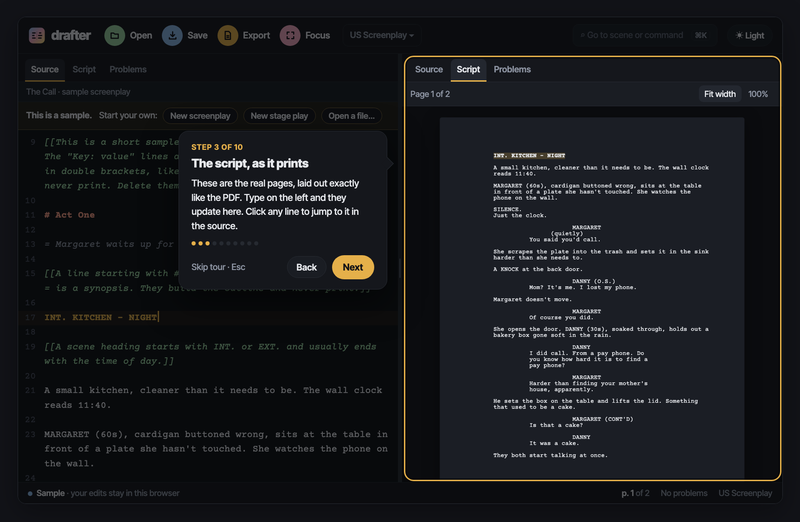
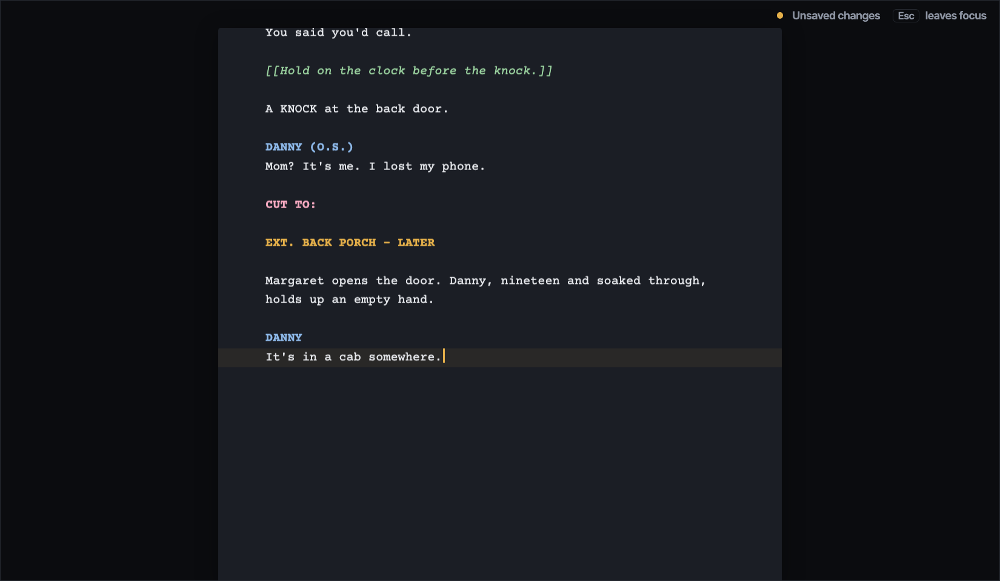

# drafter.dev — Phase 1 Design

*The first public release: the editor at drafter.dev, a sample script and a guided tour on the first visit, saving like a desktop app, and PDF export.*

Status: Draft for review · 2026-10-25 · Builds on the [architecture](drafter-architecture.md) and the [technical design](drafter-technical-design.md), both v0.2

---

## 0. How to read this

This is the plan for Phase 1, written so a builder can plan the work without going back to the maintainer. Where the architecture or the technical design already settles something, this document points there instead of repeating it, and those sections count as part of this one.

Each decision is marked by where it came from:

- **Decided:** the maintainer chose it while Phase 1 was designed, on 2026-10-25.
- **Call:** a judgment made while writing this document, open to change in review. §15 lists them.
- **Builder:** left to whoever builds it, within the limits given.

Unmarked statements restate the earlier design documents.

The mockups made during the design are in [`phase1/`](phase1/): two HTML pages you can open and click, and their screenshots. They set the look and the behavior, not pixel values.

| | |
|---|---|
|  |  |
| The editor ([`editor.html`](phase1/editor.html)) | The light theme |
|  |  |
| A first visit ([`first-visit.html`](phase1/first-visit.html)) | One step of the tour |
|  | |
| Focus mode, with typewriter scrolling | |

## 1. What Phase 1 is, and why

Phase 1 is Drafter's first public release. The ordering rule in architecture §13 governs it: the reasons to choose Drafter over Beat must be on screen at the first release. Those are the split between source and script, the Problems pane, stage plays as a first-class format, accessibility, and a web address that works anywhere without an account.

People will find drafter.dev through search and shared links, many of them on phones. They should see a real script within seconds, understand the idea without reading about it, and be one step from starting their own script or opening one they already have.

**Done when:**

1. A person can write a feature or a play in it, and the script is built for screen readers to read by its structure. The roadmap's definition says "a screen-reader user can read it"; in Phase 1 that's checked by automated tests (item 5), and confirmed with NVDA and VoiceOver in Phase 2. Decided.
2. A first-time visitor lands on a formatted sample script, can take or skip a two-minute tour, and can start a new screenplay or stage play, or open their own file, in one step.
3. The Script pane matches the exported PDF line for line, and typing never stutters, even in a 120-page script.
4. No path loses typed text: the recovery copy, the leave warnings, the two-tab guard (§9.5), and the check for a file changed elsewhere (§9.6) all work as specified.
5. axe reports no violations in either theme, on desktop or at phone width. Keyboard-only use is tested end to end. Tests also assert the accessibility tree a screen reader reads: headings, landmarks, labels, and live-region announcements.
6. It's live at drafter.dev, and a shared link shows Drafter's title, description, and share image.

## 2. Goals, non-goals, and anti-goals

**Goals.** Everything in architecture §13's Phase 1 entry, plus what this design adds:

- The first visit: the sample screenplay open in the editor, a welcome dialog, and a guided tour (§4). Decided.
- The editor laid out like the Inform 7 IDE, dark by default, with a light theme (§5). Decided.
- Autocomplete for character names and locations, as technical design §3.4 specifies (§5.3). Decided.
- Focus mode and typewriter scrolling (§7). Decided.
- A sprint timer, a daily goal, and a count of pages, scenes, words, and running time (§7.3). Decided.
- Syncing through Dropbox, Google Drive, or iCloud folders, using ordinary Save on Chrome and Edge, explained in the docs (§9.2). Decided.
- Working on a phone, one pane at a time (§12). Call.

**Non-goals for Phase 1.** Each has a later home (§14):

- The Outline, Cards, Notes, Stats, and Reference tabs; the Beat Board and storylines; writing history by day; spellcheck with nspell; snapshot history and Compare (Phase 2).
- Final Draft import and export; the TV, radio, and UK templates; user templates (Phase 3).
- Read aloud; revision marks and colored pages; the "clean" display mode; the guided install flow (Phase 4).
- Direct Open and Save for Dropbox and Google Drive (a later phase).
- Scene-number options in the app; the CLI already has `--scene-numbers`. Call: they arrive with production revisions in Phase 4.

**Anti-goals.** Phase 1 has failed, even if every feature works, if:

- Using Drafter needs an account, or a script leaves the writer's device. Drafter makes no network requests after it loads (technical design §14), so there's no analytics and no telemetry.
- The first visit reads as a marketing page instead of the tool itself.
- The tour nags: it comes back after being dismissed, can't be skipped, or can't be used with a keyboard or a screen reader.
- Typed text can be lost in any way the design doesn't warn about.
- The editor hides Fountain's markup or changes text behind the writer's back. Markup stays visible (architecture §2).
- The Script pane and the PDF disagree.

## 3. Constraints

- **Clean room.** No code, tests, or fixtures from any screenwriting application or Fountain library, and no Fountain-parsing package (README, "Clean-room implementation"). Every new dependency gets its entry in `docs/DEPENDENCIES.md` before it's added, saying why it's needed and confirming it isn't a screenwriting tool. §13 lists the expected ones.
- **No server.** A static site on Netlify, with no functions. Fonts, icons, and scripts all come from drafter.dev itself, under the content security policy in technical design §14.
- **Phase 0's engine.** The app uses `@drafter/fountain`, `@drafter/templates`, `@drafter/layout`, and `@drafter/render-pdf` through their public APIs. A change the app needs goes into the package, with tests, like any engine change.
- **Tooling** as in Phase 0 (Node 22.13 or later, pnpm 10, strict TypeScript and ESM, tsdown, Vitest projects, Biome, fast-check), plus Nuxt 4, Nuxt UI v4, CodeMirror 6, and Playwright (architecture §3).
- **Accessibility:** built to WCAG 2.2 AA (technical design §13). **Decided:** testing with NVDA and VoiceOver moves to Phase 2, and until it's done Drafter doesn't claim conformance.
- **Process** as in Phase 0: tests first, a README for every package, the changelog updated with every push, and choices the design leaves open recorded in `docs/DECISIONS.md`.

## 4. The first visit

### 4.1 What a new visitor sees

**Decided.** drafter.dev opens straight into the editor. In a browser that holds no scripts yet:

1. The editor loads with the sample screenplay, `samples/screenplay.fountain` (a title page and two pages of script), with the source on the left and the formatted pages on the right.
2. A welcome dialog offers a two-minute guided tour, or "No thanks, I'll look around."
3. A bar above the sample reads "This is a sample. Start your own:" with **New screenplay**, **New stage play**, and **Open a file…**.

**Call.** The sample opens with the cursor on its first scene heading, source line 17, so both panes show the story rather than the mostly empty title page.

### 4.2 The sample is a real, editable script

**Call:**

- Visitors can type in the sample and watch the pages change, which is the quickest way to understand Drafter.
- The sample's edits are kept in the browser like any recovery copy, but Drafter never warns about leaving a sample with unsaved changes, because it isn't the visitor's work yet.
- Save on the sample works as Save As: it writes a new file, and from then on the script is the visitor's own, under the usual saving rules.
- **Reset sample**, in the command palette and the Help menu, restores the original text.
- The stage-play sample, `samples/stage-play.fountain`, is under **Open → Samples**, beside the screenplay.

### 4.3 Returning visitors

**Call.** A browser that already holds a script opens the most recently edited one, restored from its recovery copy (architecture §6.2), with no welcome dialog and no sample bar. The samples stay under **Open → Samples**, and **Help → Take the tour** replays the tour.

### 4.4 The guided tour

**Decided.** The tour is built with ICJIA's [`nuxt-guided-tour`](https://github.com/icjia/nuxt-guided-tour) module: MIT-licensed, on npm, written by Drafter's maintainer, and the module behind the tour on markdown.icjia.cloud. Its parts map onto the tour like this:

| Module part | Use in Drafter |
|---|---|
| `TourWelcome` | The welcome dialog (§4.1). |
| `TourIntro` | One card, "Fountain in 30 seconds": a few lines of Fountain and what each becomes. |
| `TourOverlay`, with the `useGuidedTour` composable | The steps. Each highlights one part of the screen; arrow keys move between steps and Esc leaves; focus stays in the dialog; each step is announced to screen readers. |
| `TourTrigger` | **Help → Take the tour**. |

**Call.** The steps follow. The builder polishes the wording and may merge steps, keeping the tour near two minutes.

| # | Target (`data-tour`) | Says, in substance |
|---|---|---|
| 1 | `source` | You write here, in plain text, and any app can open the file. |
| 2 | `script` | The real pages, exactly as they'll print. Type and they update; click a line to jump to it. |
| 3 | `source` | Tab on a blank line starts a character, and names you've used come up as you type. After `INT.` or `EXT.`, so do your locations. Enter moves on. |
| 4 | `problems` | Like spell-check for format: a note left open, a name with no dialogue under it. Click one to jump there; many have a fix. |
| 5 | `template` | Screenplay or stage play: the same text, two formats. |
| 6 | `save` | Saves a `.fountain` file. On Chrome and Edge it saves straight back to the file, so a script in a Dropbox or Google Drive folder syncs. Other browsers download a copy. |
| 7 | `status` | Whether the script is saved, the recovery copy this browser keeps as you type, and the page count, which opens counts, a daily goal, and sprints. |
| 8 | `export` | PDF to send, plain text to paste anywhere. |
| 9 | `focus` | Focus mode and typewriter scrolling. |
| 10 | `palette` | Every command, and every scene by name: ⌘K or Ctrl+K. |

The intro card's examples (Call): `INT. KITCHEN - NIGHT` is a scene heading; a name in capitals with a line under it is a character and what they say; `(quietly)` under a name is a parenthetical; `CUT TO:` is a transition; and `[[a note]]` never prints.

What reading the module (v0.5.1) showed, for the build:

- **Content security policy.** The module adds a small inline `<style>` for its highlight color. Its content is fixed at build time, so the policy can allow it by hash. Its components use Heroicons, which must be bundled (`@iconify-json/heroicons`), as Drafter's policy already requires of all icons. Builder: if the hash is awkward, an option in the module to skip the inline style is a small upstream change.
- **Color.** The highlight is Drafter's goldenrod, `#E5B04A`, set with the module's `highlightColor` option or its `--tour-*` CSS variables.
- **Hidden targets.** On a phone, a step can point at a pane that isn't showing. Drafter watches the tour's current step and switches panes first; the module highlights its target after Vue's next tick, by which time the pane is there. Builder: a per-step "before" hook in the module would be tidier, but isn't required.
- **Remembering.** The module stores "tour seen" in localStorage under a versioned key. Raise the version when the tour changes enough to show it again.
- **The step card** sits in the middle of the screen while the target glows, as on markdown.icjia.cloud, not beside the target as in the mockup. That also suits a phone better.

### 4.5 What search engines and link previews see

**Call:**

- `/` is prerendered with the page title, description, canonical address, Open Graph and Twitter tags pointing at `brand/og-image.png`, the favicons, and the web app manifest.
- The prerendered page also carries a short plain description of Drafter, so it means something to a search engine and to someone without JavaScript. The editor itself runs in the browser.
- Phase 1 also prerenders three help pages under `/docs`: **Saving and your browser** (the browser table, architecture §6.1), **Keyboard shortcuts** (generated from the command registry, §5.4), and **Privacy** (Drafter never sends your script anywhere). The full docs site stays in Phase 5.

This replaces the route plan in technical design §16, where `/` was a marketing page and the editor lived at `/editor`.

## 5. The editor

### 5.1 Layout

**Decided,** from the approved mockup:

- Two facing panes, like the Inform 7 IDE. Each has its own row of tabs and can show any tab, with Source on the left and Script on the right by default. The divider between them resizes.
- A toolbar of round, labeled action buttons across the top, and a status bar across the bottom.
- Under each pane's tabs, a slim bar for that pane: the file name in the Source pane; the page indicator and **Fit width / 100%** in the Script pane.
- Phase 1's tabs are **Source**, **Script**, and **Problems**, the last with a count badge.
- Dark by default, with a Light / Dark toggle in the toolbar (§8).

**Call:**

- Tabs for later phases appear when they're built, not before.
- A tab shows in one pane at a time. Choosing a tab that's open in the other pane swaps the two panes' tabs, so there is always one editor, one Script view, and one Problems list: one undo history, one cursor driving the Script pane and the status bar, one `data-tour` target for each, and nothing for a screen reader to tell apart. A second view of the source, to read one scene while writing another, can come later.
- The toolbar holds the Drafter mark and wordmark (logo option 3 from `brand/`), **Open**, **Save**, **Export**, and **Focus**; the template switcher; a field that opens the command palette, "Go to scene or command ⌘K"; and the theme toggle. The earlier mockup's **Read aloud** button (Phase 4) and **Reference** search (Phase 2) wait for their phases.
- Every command is in a menu, in the command palette, and on a keyboard shortcut where it has one. The mark opens the app menu: New screenplay, New stage play, Open, recent scripts, samples, Save, Save As, Revert to Saved, Export, Settings, and Help. The toolbar repeats the frequent ones.
- The browser tab's title is the script's title and "Drafter", with a dot while there are unsaved changes: "• The Call — Drafter".

### 5.2 Colors and type

**Decided:** the mockups set the direction. **Call:** the exact values, kept in one set of design tokens.

- The interface is set in Inter Tight; everything that is script, source or pages, in Courier Prime. Both fonts are under the SIL Open Font License and served from drafter.dev: Courier Prime is already in `packages/render-pdf/fonts/`, and Inter Tight in `brand/fonts/`.
- The source is colored from the revision palette:
  - scene headings in goldenrod, bold
  - character cues in blue, bold
  - transitions in pink, bold
  - notes in green italic
  - title-page keys and sections in salmon
  - parentheticals and synopses in muted italic
  - Fountain's markers (`!`, `@`, `.`, `>`, `#12#`) dimmed
- In the dark theme the pages are dark with light ink, as in the mockup; in the light theme they're white with black ink. Exported PDFs are always black on white.

**Builder:** the mockups' faintest grays fail contrast. The gutter's line numbers and the placeholder text come to about 3:1 on the dark background. Every color that carries text must reach 4.5:1 (3:1 for large text and for the edges of controls), in both themes, per WCAG 1.4.3 and 1.4.11. Adjust the tones and keep the look.

### 5.3 The Source pane

As technical design §3 specifies:
- highlighting from the one parser, by decorations
- the Tab and Enter keymap
- autocomplete
- folding by scene and section
- the mapping between the cursor and the element it's in
- lint markers in the gutter

CodeMirror also supplies search (`Mod+F`), undo, and redo.

**Decided: autocomplete** for character names and locations is part of Phase 1. As technical design §3.4 specifies:
- **Character names:** a list of names already used in the script comes up on a character line, either after Tab on a blank line or once two letters are typed, and `Ctrl+Space` brings it up anywhere. It's ranked by most recent use, then by frequency, with extensions such as `(V.O.)` offered next.
- **Scene headings:** after `INT.` or `EXT.`, the locations already used come up; after the ` - `, the times of day (`DAY`, `NIGHT`, `CONTINUOUS`, `LATER`, and any used before).
- **Transitions and sections:** transitions on a line starting with `>`, and section titles after `#`.

Completion never inserts on Enter unless its list is open and an item is selected.

**Call: spellcheck.** The technical design turns the browser's spellcheck off so it can't disagree with nspell, but nspell arrives in Phase 2, and a first release with no spellcheck would be a step back for writers. Phase 1 turns the browser's own spellcheck on in the Source pane, with a setting to turn it off, and Phase 2 replaces it with nspell as designed.

### 5.4 Commands, shortcuts, and the palette

- `Mod+K` opens the command palette (technical design §13). It lists every command with its shortcut, plus **Go to scene**, which lists every scene heading by name, and **Go to line**. Call, for the last two.
- The keymap in technical design §3.3 stands. Phase 1's new commands (focus mode, typewriter scrolling, theme, the tour) get shortcuts only where they don't collide with the browser's or the operating system's. Builder: choose them. The **Keyboard shortcuts** page lists every shortcut, generated from the one command registry so it can't drift.
- `F6` moves between the panes (technical design §13).

### 5.5 The Script pane

As technical design §5.7 and §6.1:
- pages from the same layout as the PDF, laid out in a Web Worker
- click a line to jump to it in the source
- scrolls along with the cursor
- held back until Courier Prime has loaded, so every column is exact
- navigable by headings (technical design §13)

The slim bar shows **Page N of M** and offers **Fit width**, where the page fills the pane, and **100%**, real size.

### 5.6 The Problems tab

Phase 1 ships these rules from technical design §9, on top of the parse diagnostics:
- `unclosed-region`
- `character-without-dialogue`
- `manual-contd`
- `heading-no-time`
- `similar-names`
- `transition-not-last`
- the Strict Fountain rules, `heading-blank-after` and `multiline-parenthetical`

Clicking a problem jumps to its place. A problem with a fix offers it there and in the gutter. The **Strict Fountain** setting raises the Strict rules to warnings and adds **Fix all**. The count shows on the tab and in the status bar.

### 5.7 The status bar

From the left:
- whether the script is saved to its file, as "Saved 2 min ago" or "Unsaved changes" (technical design §8.2)
- the recovery copy's state (technical design §8.3)
- the current page
- the problem count
- the template

**Call:** while a sample is open, the first item reads "Sample · your edits stay in this browser," as in the mockup.

## 6. Templates and new scripts

The template switcher offers **Screenplay** (`us-screenplay`) and **Stage play** (`stage-play-standard`), Phase 0's two built-ins. Choosing one is an ordinary, undoable edit to the script's metadata block (technical design §8.6), so the choice travels with the file.

**Call:**

- **New screenplay** and **New stage play** open a new script with a short title page to fill in (Title, Credit, Author, Draft date) and the cursor on the first line after it. A new stage play also gets the metadata block naming its template. Builder: settle the exact text, which must parse as a title page.
- A new script has no file until its first Save, which asks where to put it on Chromium and downloads it elsewhere.

## 7. Focus mode, typewriter scrolling, goals, and sprints

**Decided:** all of these are in Phase 1. The interactive mockup is the reference for focus mode and typewriter scrolling.

### 7.1 Focus mode

**Call:**

- It hides the toolbar, the rows of tabs, the slim bars, the status bar, and the other pane, and sets the source in a page-width column in the middle of the screen.
- Esc, or the command that entered it, leaves it.
- A small marker stays in a corner showing whether the script is saved, because architecture §6.2 promises unsaved changes are always visible. The tab title keeps its dot too.
- It doesn't put the browser in full screen, though the browser's own full screen works with it.

### 7.2 Typewriter scrolling

**Call:**

- It keeps the line being typed at the middle of the Source pane, so the text scrolls up instead of the cursor sinking down the screen. Space above and below lets the first and last lines reach the middle.
- It's a separate setting that works with or without focus mode. Its toggle is in the Source pane's slim bar, the View menu, and the palette.
- When the system asks for reduced motion, the text moves without animating.

Drafter remembers both settings in the browser.

### 7.3 Counts, goals, and sprints

**Decided:** a light version arrives in Phase 1. The Stats tab and the history by day follow in Phase 2.

**Call:**

- **Counts.** Clicking the page count in the status bar opens a small panel with the pages, scenes, and words, and the running time at the usual page a minute. Words are counted in the text that prints, so notes, boneyard, and the metadata block don't count.
- **A daily goal.** Set a goal for the day in pages or words, and the status bar shows progress toward it: "1.5 of 3 pages today." Progress is how much the script has grown since the day began, not how many keys were pressed, so cutting a scene counts against it. It's kept per script, in this browser.
- **Sprints.** Start a sprint of 15, 25, or 45 minutes, or any length, from the panel or the palette.
  - The status bar shows the time left, and so does focus mode's corner marker.
  - When time is up, a quiet notice says what the sprint added. It makes no sound unless asked to.
  - A sprint can be paused, stopped, or hidden (WCAG 2.2.2).
  - Screen readers don't hear the countdown every second, only the end, once.

## 8. Themes and settings

**Decided:** dark by default for everyone, light one click away, and the choice remembered.

**Call:** settings live in IndexedDB's `settings` table (technical design §8.1). Besides the theme, they cover:
- "Match system appearance," off by default
- the text size, which scales both panes evenly so pagination doesn't change (technical design §13)
- spellcheck (§5.3)
- typewriter scrolling (§7.2)
- Strict Fountain (§5.6)

This updates technical design §13, which has the app follow `prefers-color-scheme`.

## 9. Saving and files

### 9.1 As designed

Architecture §6 and technical design §8 stand:
- Save, Save As, and Revert to Saved
- the leave warnings
- the recovery copy, written as you type
- `storage.persist()`, and the warnings when storage isn't safe
- save in place on Chromium through the File System Access API, with the check for a file changed elsewhere that §9.6 describes
- download in other browsers

### 9.2 Synced folders

**Decided:** in Phase 1, scripts sync through folders, not through cloud services' APIs. On Chrome and Edge, Save writes back to the file, so a script kept in a Dropbox, Google Drive, or iCloud Drive folder syncs through that service's own app. On a Chromebook, Google Drive appears in the save dialog itself. **Saving and your browser** (§4.5) explains this in a short paragraph. Direct **Open from** and **Save to** for Dropbox and Google Drive come in a later phase (§14).

### 9.3 Opening

Open takes a file from the picker or one dropped on the window: `.fountain` or `.txt` (architecture §6).

**Call:** the Open menu also lists:
- the scripts this browser keeps, most recent first, each with a way to remove it from the browser (which asks first and never touches a file)
- the two samples

### 9.4 Revert to Saved

Technical design §8.2 restores the snapshot taken at the last save.

**Call:** Phase 1 keeps only that one snapshot per script: the text as last saved to its file, which `savedHash` is computed from. The full snapshot history, its retention, and Compare are Phase 2 (technical design §8.4).

### 9.5 The same script in two tabs

**Call:** two browser tabs editing one script would overwrite each other's recovery copy. So while a script is open for editing in one tab, it opens read-only in any other, with an **Edit here instead** button that moves editing to that tab. Builder: use the Web Locks API or a BroadcastChannel.

### 9.6 A file changed somewhere else

**Decided:** with synced folders (§9.2), a script's file can change on another computer while this browser's copy stays as it was. Drafter checks the file before anyone types over it.

- **When a script that has a file opens,** Drafter reads the file before editing starts. If the browser already allows that ("Allow on every visit"), the check is automatic. Otherwise the script opens read-only under a bar, "This script is saved in The Call.fountain," with **Check for changes**, which asks for permission and checks in one click.
- **If only the file changed,** the file wins: Drafter loads it and says "Updated from The Call.fountain."
- **If both changed,** meaning the file and also unsaved changes in this browser, Drafter asks which to keep working on: **Open the file** or **Keep this browser's version**. Either way, the other is kept as a separate script in this browser, named so it's clear where it came from, and nothing is lost.
- The same check runs when the window regains focus, as technical design §8.5 says. This flow replaces that section's "reload / keep mine / snapshot both" prompt, since Phase 1 keeps no snapshot history.

**Call:**
- If the file can't be read because it was moved or deleted, or its drive is gone, Drafter says so and offers **Save As** or **Edit this browser's copy**.
- In browsers that save by download (Firefox, Safari, Brave), opening a file with the same title as a script already in the browser asks whether to replace that script or open the file beside it.

## 10. Export

**Export** offers **PDF** and **Plain text (.txt)**, each file named after the title page's Title.

- PDF comes from `@drafter/render-pdf` in a worker (technical design §6.2), with Courier Prime loaded from the app's own files.
- Plain text matches what `drafter build --txt` writes. **Call:** the text renderer moves out of `@drafter/cli` (`renderText`, in `packages/cli/src/txt.ts`) into a package both use, so the app doesn't depend on the command line. Builder: put it in `@drafter/layout` or a small new package.

## 11. Offline, installing, and updates

**Call:** Phase 1 ships the web app manifest with the `brand/` icons, plus a service worker (`@vite-pwa/nuxt`, technical design §16) that caches the app, so Drafter works offline after the first visit. Drafter's storage warning tells Safari users that installing (Add to Dock, or Add to Home Screen) keeps their recovery copy safe, and the manifest makes that install work properly. The guided install flow stays in Phase 4.

When a new version is deployed, Drafter says so and offers **Reload**. It never reloads by itself, and if a reload would leave unsaved changes behind, it says so first. Those changes stay in the recovery copy either way.

## 12. Phones and small screens

**Call:**

- Below a width the builder chooses, one pane shows at a time, and the tab row switches among Source, Script, and Problems. A first visit on a phone opens on the Script pane, the quickest way to see what Drafter does.
- The toolbar folds into a menu, and the tour adapts (§4.4).
- Phase 1 adds no phone-only writing tools. Fountain needs no special keys, and the Enter conveniences work with an on-screen keyboard, so a phone can read, edit, save by download, and export. A tablet with a keyboard behaves like a desktop.

## 13. What gets built

| Piece | What it is | Design |
|---|---|---|
| `@drafter/cm-fountain` | CodeMirror 6 integration: the parse state, decorations, keymap, autocomplete, folding, and cursor mapping | technical design §3 |
| `@drafter/render-html` | The Script pane's renderer | technical design §6.1 |
| `@drafter/lint` | The Phase 1 rules and their fixes | technical design §9 |
| The text renderer | `renderText`, moved out of the CLI | §10 |
| `apps/web` | The Nuxt 4 app: everything else in this document | this document |

These new dependencies are expected, and each needs its entry in `docs/DEPENDENCIES.md` first:
- `nuxt` and `@nuxt/ui`
- the CodeMirror 6 packages: `@codemirror/state`, `view`, `commands`, `language`, `autocomplete`, and `search`
- `dexie`, `@vueuse/core`, `nuxt-guided-tour`, and `@vite-pwa/nuxt`
- an `@iconify-json/*` icon set
- for tests, `@playwright/test`, `@axe-core/playwright`, and `jsdom`

None of them is a screenwriting tool. `@codemirror/language` supplies folding, not a grammar.

### Deployment and launch

**Decided:** the maintainer points the existing Netlify site for drafter.dev at this repository. The site currently serves a placeholder.

**Call:**

- The repository carries the deploy configuration: `netlify.toml`, with the build command, publish directory, and Node version, and `_headers`, with the content security policy (technical design §14 and §16).
- Phase 1 is built on the `phase-1` branch and checked on Netlify's deploy previews, from a pull request into `main`. drafter.dev serves `main`, which gets Phase 1 only when it's done.
- Until Phase 1 is done, the site's production build is held back, so the placeholder stays live. Netlify's **Stop auto publishing** does this.

**Decided:** the NVDA and VoiceOver passes move to Phase 2. Phase 1 builds to the accessibility design in technical design §13 and checks it automatically in Playwright:
- axe
- keyboard-only tests
- assertions on the accessibility tree: headings, landmarks, labels, and live-region text

## 14. Roadmap changes

**Decided,** and reflected in the README and architecture §13:

- **Phase 1** adds:
  - the first visit, with its sample and tour
  - focus mode and typewriter scrolling
  - a sprint timer, a daily goal, and counts
  - the Inform-style layout, with the dark theme by default
- **Phase 2** adds:
  - a **Beat Board**
  - **storylines**
  - writing statistics by day, kept on the device
  - testing with NVDA and VoiceOver
  - character tools: screen time per character, and who shares scenes with whom
- **Phase 3** adds importing Highland, Fade In, and Celtx files, and a template for novels or graphic novels.
- **Phase 4** adds:
  - alternate versions of a line, switchable in place
  - production revisions: locked pages (12A), scenes marked OMITTED, and scene numbers that start anywhere
- **A later phase** adds direct Open and Save for Dropbox and Google Drive. People sign in with Dropbox or Google in their own window, never with Drafter, and nothing passes through a Drafter server. It needs an app registered with each service, a verified domain, and a privacy page.

**Call: Beat Board and storylines in Phase 2,** with the Outline and Cards they build on, and their shape here:
- **The Beat Board** is a free canvas of idea cards that can be colored, linked, and moved into the outline. The ideas live in the file as Fountain: placed beats are synopses (`=` lines), and beats not yet placed wait in a boneyard section that never prints. Where each card sits, its color, and the links between cards travel in the metadata block. Every drag has a keyboard equivalent, and the board can also be read as a list (architecture §12).
- **Storylines** tag scenes with A, B, and C plots, or with names, each in its own color, stored in the metadata block like scene colors. The Outline shows them as lanes along a timeline measured in pages; the Cards and the Beat Board are colored by them; and the Script pane can mark them in the margin.

**Call: these stay off the roadmap:**
- real-time collaboration and cloud workspaces, which need accounts and a server
- production tagging, scheduling, and budgeting, which are production tools rather than writing tools
- Beat's macros and markers, syntax other Fountain apps can't read

## 15. Calls to check

Each is marked **Call** where it appears.

| § | Call |
|---|---|
| 2 | Scene-number options wait for Phase 4. |
| 4.1 | The sample opens at its first scene heading. |
| 4.2 | The sample is editable: its edits stay in the browser without leave warnings, Save on it works as Save As, and **Reset sample** restores it. The stage-play sample is under Open → Samples. |
| 4.3 | Returning visitors open their most recent script, with no welcome. |
| 4.4 | The ten tour steps and the intro card's examples. |
| 4.5 | `/` is the editor, prerendered with its metadata and a short description; three help pages under `/docs`. |
| 5.1 | Later tabs stay hidden until built; a tab shows in one pane at a time, and choosing one that's open in the other pane swaps them; the toolbar's contents; the app menu behind the mark; the dot in the tab title. |
| 5.2 | The exact colors, with the faint grays raised to pass contrast. |
| 5.3 | The browser's spellcheck is on until nspell arrives in Phase 2. |
| 5.4 | **Go to scene** and **Go to line** in the palette. |
| 5.7 | The status bar's wording for a sample. |
| 6 | New scripts start with a title page to fill in. |
| 7.1, 7.2 | Focus mode's details, including the saved marker and no forced full screen; typewriter scrolling as a separate setting. |
| 7.3 | How counts, the daily goal, and sprints work: progress as the script's growth since the day began, the sprint lengths, and a quiet notice at the end. |
| 8 | "Match system appearance," off by default, among the settings. |
| 9.3 | The Open menu lists this browser's scripts and the samples. |
| 9.4 | Revert to Saved keeps only the last-saved text until Phase 2. |
| 9.5 | The two-tab guard. |
| 9.6 | What happens when a file can't be read, and when a downloaded file matches a script already in the browser. |
| 10 | The text renderer moves out of the CLI. |
| 11 | The manifest and service worker ship in Phase 1, with a Reload prompt for updates. |
| 12 | Phones show one pane at a time and open on the Script pane, with no phone-only tools. |
| 13 | The deploy configuration lives in the repository; Phase 1 is checked on deploy previews and published from `main` when done, with production publishing held back until then. |
| 14 | The Beat Board and storylines in Phase 2, in the shape described; what stays off the roadmap. |

## 16. Left to the builder

- Component structure, state management, and how the app talks to its workers.
- The width where the layout drops to one pane, the icon set, and the wording of the tour, the dialogs, and the help pages, in plain language.
- Shortcuts for new commands (§5.4), the text of a new script (§6), where the text renderer lives (§10), and how the two-tab guard hands over (§9.5).
- How the tests are organized, within technical design §15:
  - Vitest for the packages
  - Playwright for the app, in Chromium, Firefox, and WebKit at desktop and phone sizes
  - axe on every major state: the first visit, each tour step, editing, Problems, focus mode, each dialog, and both themes

## 17. Changes to the earlier documents

These follow once this design is approved:

- **Technical design §13:** the dark theme is the default; following the system's appearance is a setting.
- **Technical design §16:** `/` is the editor, prerendered with its metadata; `/docs/**` is prerendered; there's no `/editor` route.
- **Technical design §10:** Phase 1 uses the browser's spellcheck until nspell arrives.
- **Architecture §2:** either pane can show any tab, one pane at a time.
- **Technical design §8.5:** the prompt for a file changed elsewhere becomes the flow in §9.6.
- **Architecture §12 and technical design §13:** WCAG 2.2 AA remains the target from the first release. The NVDA and VoiceOver passes come in Phase 2, and until they're done Drafter doesn't claim conformance.

The roadmap changes in §14 are already in the README and in architecture §6 and §13.
