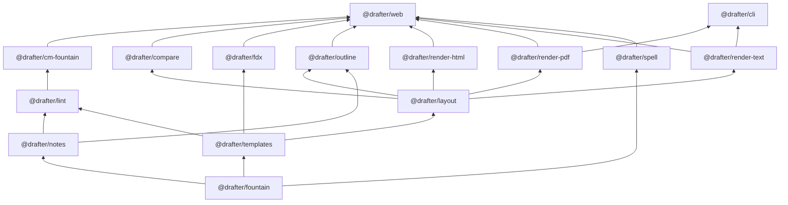
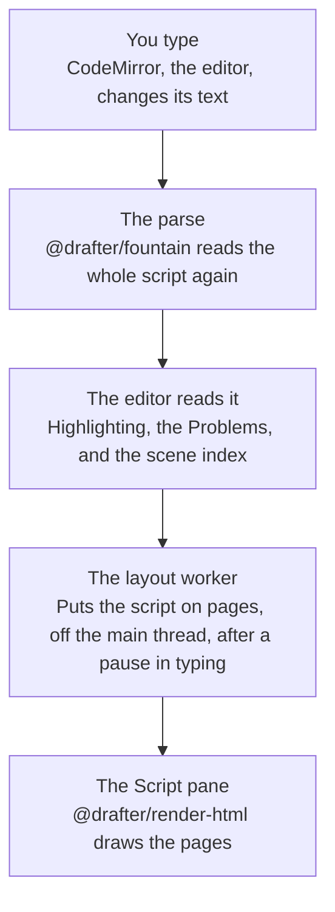
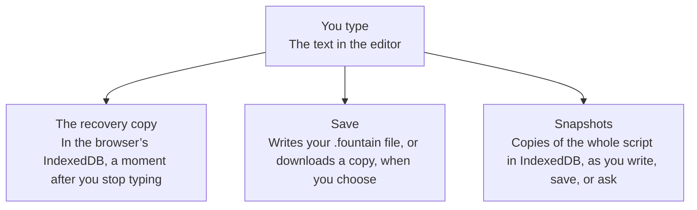
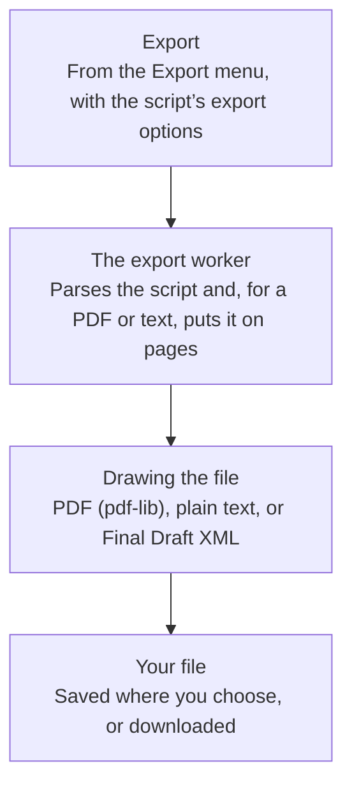
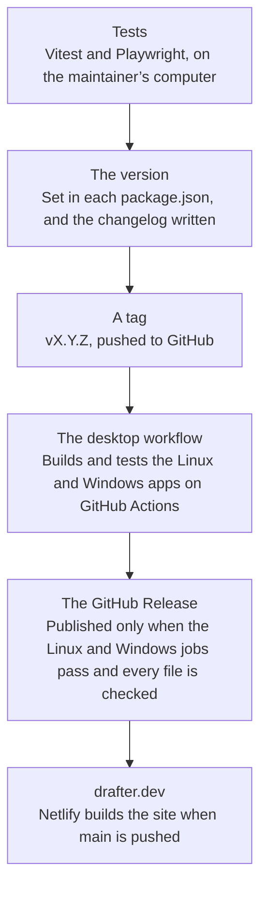

# Technical details

<!-- Generated from apps/web/app/about/tech.ts by apps/web/test/tech.test.ts; to change it, change tech.ts and run `pnpm --filter @drafter/web test -- tech -u`. -->

How Drafter is put together, for the curious: each part starts in plain words, then gives the names and the details. Nothing here is needed to write with Drafter.

The same page is in Drafter, under Help → Technical details, and at [drafter.dev/docs/technical](https://drafter.dev/docs/technical/), where the diagrams are drawn as lists of boxes.

## Contents

- [The short version](#the-short-version)
- [How it’s organized](#how-its-organized)
- [From a keystroke to the page](#from-a-keystroke-to-the-page)
- [Where your script is kept](#where-your-script-is-kept)
- [Exporting](#exporting)
- [Working offline](#working-offline)
- [The desktop app](#the-desktop-app)
- [The clean-room rule](#the-clean-room-rule)
- [How a release ships](#how-a-release-ships)
- [What it depends on](#what-it-depends-on)

## The short version

Drafter is a web app that runs entirely in your browser, or in a window of its own on the desktop. There is no server behind it and no account to make: once the page has loaded, everything happens on your device, and your script never leaves it.

drafter.dev is a set of static files: HTML, JavaScript, CSS, fonts, and dictionaries, built with Nuxt and Vue and served by Netlify. Nothing on the site runs code for you or stores anything. It is written in TypeScript, and every part of it, down to the Fountain parser, is Drafter’s own, written from public specifications (the clean-room rule, below).

## How it’s organized

Drafter is built from small pieces, each with one job: one reads Fountain, one puts a script on pages, one draws a PDF, and so on. The app sits on top and puts them together. A piece only uses the pieces beneath it, so each can be tested on its own.

One repository holds them all as pnpm workspaces: the engine packages in `packages/` (published as `@drafter/*`), the app in `apps/web`, and the desktop app in `apps/desktop`. Only `@drafter/cm-fountain` knows about CodeMirror, and only it and `@drafter/render-html` touch a web page; the rest run anywhere Node does, which is how the command line uses them.

*Drafter’s packages in layers: each one uses only packages in the layers below it, and the parser, which uses none, is at the bottom. Each use shown, a line or a “uses”, is a direct one; a package also uses whatever those use.*

The desktop app isn’t drawn: it uses none of the packages directly, and serves the web app’s finished build instead.

## From a keystroke to the page

When you type a letter, Drafter reads the whole script again. That sounds slow, but Fountain is simple to read, and even a long script takes a moment too short to notice. Everything else, the colors, the Problems, the Outline, reads that one reading, so they always agree. Putting the script on pages takes longer, so that happens to one side, without holding up your typing.

*From a keystroke to the page: the editor, the parse, then everything that reads it.*

- **The editor** is CodeMirror 6. `@drafter/cm-fountain` keeps the parse in the editor’s state: `parse` once, then `reparse` on every change, which parses the full text again.
- **The parse** is `@drafter/fountain`, a lossless parser: printing the tree gives back exactly the text it read, spaces and mistakes included. There is no second grammar for highlighting; the colors come from the same parse, drawn for the part of the script on screen.
- **The Problems** are `@drafter/lint`’s rules, run on the parse, with any fixes they offer as text changes. **The scene index** (`@drafter/outline`) feeds the Outline, Cards, and the Structure strip, with each scene’s pages and running time.
- **The layout** is `@drafter/layout`, in a Web Worker (`layout.worker.ts`): 50 ms after you stop typing, the text goes to the worker, which parses it and paginates it by the template. A slower, older layout never replaces a newer one.
- **The Script pane** is `@drafter/render-html`, which draws those pages as positioned HTML a screen reader can follow.
- A Markdown document has its own worker (`markdown.worker.ts`), which reads it with `mdast-util-from-markdown` for the Preview. Spellcheck has one too (`spell.worker.ts`): `@drafter/spell` loads a dictionary into nspell there and checks the script’s words, so typing never waits on it.

## Where your script is kept

While you write, your browser keeps a recovery copy of the script, updated as you type, so a crash or a closed tab loses almost nothing. When you save, Drafter writes your script to a file on your computer: a plain `.fountain` file that any text editor can open. Along the way it keeps snapshots, earlier copies you can go back to.

*Where your script is kept: the text in the editor goes three ways, each in its own time: a recovery copy as you type, your file when you save, and snapshots along the way.*

- **The recovery copy** is in the browser’s IndexedDB, through Dexie. It is written 750 ms after you stop typing, or every 5 seconds while you keep going. The database has five tables: `projects`, `snapshots`, `templates`, `handles`, and `settings`.
- **Only one tab edits a script.** A second tab with the same script open shows it read-only, so two tabs never write one recovery copy.
- **Save** goes through one interface, `FileAccess`. In Chrome and Edge it uses the File System Access API to save back to the file you opened; Firefox and Safari can’t, so Save downloads a complete copy. The desktop app reads and writes files by path, through its main process.
- **Snapshots** are copies of the whole text, in the `snapshots` table: after every 10 minutes of writing, when you save or open a file, before a change that rewrites much of it, and when you ask for one. They are compressed where the browser can, and thinned out as they age.

## Exporting

Exporting turns your script into a PDF to print or send, plain text, or a Final Draft file. It happens to one side, like the page layout, so the editor stays free while a long script is drawn, and a bar shows how far it has got.

*Exporting: the export worker lays the script out and writes the file, with a progress bar.*

- **The export worker** (`export.worker.ts`) parses the script and, for a PDF or plain text, lays it out again with the same engine as the Script pane, then hands the pages to a renderer. It reports how far it has got, at most ten times a second, for the toast’s progress bar.
- **PDF** is `@drafter/render-pdf`, with `pdf-lib`, embedding Courier Prime, the font the Script pane shows. A Markdown document’s PDF is set in Inter Tight, with Courier Prime for code.
- **Plain text** is `@drafter/render-text`: the same pages as fixed-width text. **Final Draft** is `@drafter/fdx`, which writes the XML itself, and reads `.fdx` files too.
- **Export options** are each script’s own: scene numbers (none, as written, or every scene) and the title page (full, title and author only, or none). They are kept with the script’s record in the browser, never in the script’s text.
- Where the browser has a save picker, it asks where to save; elsewhere the file downloads.

## Working offline

After your first visit, Drafter opens with no internet at all: your browser keeps its own copy of the app. You can also install it, so it opens in a window of its own like any other app. When a new version is out, Drafter tells you, and waits for you to choose when to reload.

A service worker (`/sw.js`, written at build time by `@vite-pwa/nuxt` and Workbox) precaches the app’s own files: the pages, scripts, styles, workers, fonts, dictionaries, and icons, and nothing else. A web app manifest makes it installable (a PWA). A new version waits until you reload; it never reloads a tab by itself. The site sends a strict content security policy, so a page may only load scripts from drafter.dev itself.

## The desktop app

The desktop app is the same Drafter, in a window of its own, with a menu bar and real files: it saves straight back to your file, and opens a `.fountain` file with a double-click. It needs no internet, except to check for a new version.

- It is Electron, with the web app’s build inside it, served from the app’s own files at `app://drafter/`. It has no service worker: everything is already on your computer.
- The page talks to the main process only through a small bridge (the preload), with named calls and plain data. Files go through the same `FileAccess` interface as in the browser, so the rest of the app doesn’t know which one it is in.
- For Linux there is an AppImage and a `.deb`, and for Windows an installer (x64 and Arm). A Mac app is built on your own Mac with one command, until there is a signed download.
- Updates come from GitHub Releases. The app checks once when it starts, never installs by itself, and you can turn the check off in Settings. The AppImage and the Windows app download a new version through `electron-updater` and install it when you choose Restart; the `.deb` checks the same way and offers the download page. A Mac app reads the latest release’s version with its own small check, not `electron-updater`, which installs only a signed app, and offers the download page too.

## The clean-room rule

Drafter is written from scratch. Nobody working on it reads the code of another screenwriting app or Fountain library, and nothing in it, code, text, or pictures, comes from one. What Drafter has to do comes from public, written sources; how it does it comes only from the people writing it.

So none of Drafter’s dependencies is a screenwriting tool or a Fountain library, and every sample and test script is written for the project. Reading other apps’ documentation, using them, and comparing their output are all fine. The repository has the whole statement and an audit of it.

[The clean-room statement (docs/clean-room.md)](clean-room.md)

[Clean-room implementation, in the README](../README.md#clean-room-implementation)

## How a release ships

Before a new version goes out, thousands of automatic tests check it, in three browsers. Then it gets a version number, and the Linux and Windows apps are built and tested on GitHub’s computers. The release is published only if all of those builds pass, and the website is updated after it.

*How a release ships: tests, a tag, the desktop builds on GitHub, then the website.*

- **Unit and property tests** run in Vitest (with fast-check generating scripts), and **end-to-end tests** in Playwright, in Chromium, Firefox, and WebKit, with axe checking accessibility in both themes.
- **A release** sets the version in every `package.json`, moves the changelog’s entries under it, and pushes a tag, `vX.Y.Z`, which must match the desktop app’s version.
- **The desktop workflow** (`.github/workflows/desktop.yml`) builds and tests the Linux and Windows packages, then makes the GitHub Release as a draft, uploads every file, checks them, and only then publishes it. If the Linux job or either Windows job fails, nothing is published. The Mac build is a check on branch pushes only: nothing for a Mac is published until it can be signed.
- **drafter.dev** is built by Netlify from `main`, which is pushed after the release is out, so the site’s download link never points at a release without its files.

## What it depends on

Drafter takes as few of other people’s packages as it can, and none from the screenwriting world. Here is each one the app, the desktop app, and the command line need to build and run, and what it does for Drafter.

- `nuxt`: Builds drafter.dev as a set of static files, with nothing running on a server.
- `vue`: Draws the app’s screens and keeps them up to date as you write.
- `vue-router`: Gives the app and each help page an address of its own.
- `@nuxt/ui`: The menus, dialogs, tabs, and command palette.
- `tailwindcss`: Styling, built into a stylesheet when the app is built.
- `@iconify-json/lucide`: The icons in the menus and toolbar, built into the app so none is fetched.
- `@iconify-json/heroicons`: A few icons the guided tour draws, built in the same way.
- `nuxt-guided-tour`: The welcome and the guided tour on a first visit.
- `@vueuse/core`: Small helpers the guided tour needs; Drafter’s own code doesn’t use it.
- `@vite-pwa/nuxt`: Writes the service worker that lets the app open offline, and the file that lets it install as an app.
- `dexie`: Keeps your recovery copy, scripts, and snapshots in the browser’s own database.
- `@codemirror/state`: The editor’s text, selection, and undo history, held as data.
- `@codemirror/view`: Draws the editor and handles typing, the mouse, and touch.
- `@codemirror/commands`: The editor’s everyday commands: undo, redo, and moving by word or line.
- `@codemirror/language`: Folding, and the structure of a Markdown document as the editor reads it.
- `@codemirror/search`: Find and replace in the editor.
- `@codemirror/lint`: Underlines a problem in the text and shows its fixes.
- `@codemirror/autocomplete`: Suggests character names and places as you type.
- `@codemirror/lang-markdown`: The editor’s mode for a Markdown document.
- `mdast-util-from-markdown`: Reads a Markdown document for its Preview, its word count, and its PDF.
- `pdf-lib`: Writes PDF files.
- `@pdf-lib/fontkit`: Embeds the fonts in a PDF, only the letters it uses.
- `nspell`: The spellchecker: checks each word against a dictionary and suggests corrections.
- `dictionary-en`: The American English dictionary.
- `dictionary-en-gb`: The British English dictionary.
- `commander`: Reads the command line’s options.
- `electron-updater`: Lets the Linux and Windows apps check GitHub for a new version, and the AppImage and the Windows app update themselves.

The spellchecker’s, the dictionaries’, and the fonts’ licences are given in full on the [Third-party licences](https://drafter.dev/docs/licences/) page.

Building and testing use a few more tools that never reach you: TypeScript, Vitest, Playwright, Biome (formatting and linting), tsdown (building each package), and electron-builder (packaging the desktop app).

[Why each one is allowed (docs/DEPENDENCIES.md)](DEPENDENCIES.md)
